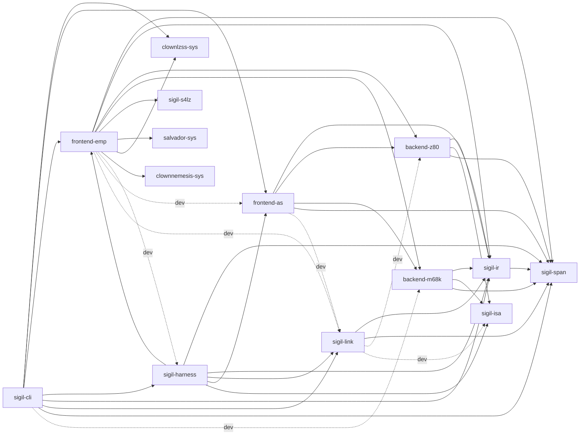

# Sigil assembler: inventory

Sigil at `master` `7630ba0d` (2026-09-28 17:47, the last commit; the source tree is clean apart from 57 untracked paths). Aeon at `936439fa`. Collected 2026-11-16. This stage is mechanical: listings and counts, plus a SHIPPED / DEBUG-ONLY / INERT / TEST-ONLY / ABSENT label on each item. It gives no verdicts.

> [!note] Headline facts (all MEASURED unless labelled)
> - **14 workspace crates**, not 13. 639 `.rs` files, **315,996 lines** in total. Code lines (no comments or blank lines): 70,743 in `src/`, 21,558 in inline `#[cfg(test)]` modules, and 114,018 in `tests/` directories. Of the non-blank `src/` lines, 37% are comments (42,378).
> - **5,870 tests** are listed by `cargo test --release --workspace -- --list` across 521 test binaries. There are 0 doctests. 3 tests carry `#[ignore]`.
> - **There is no current independent oracle for whole-ROM bytes.** `asl` has left the toolchain, and the 7 golden ROMs in `sigil-harness/golden/` were frozen by Sigil itself. The checks that do not depend on Sigil's own output are 329 frozen `asl` ISA vectors, the Capstone differentials (Python `capstone` 5.0.7 is installed) and the AS-front-end-vs-`.emp` `*_port` gates.
> - **Debug info is symbol-only.** The `.lst` has label, equate and phase tables, a Source Digest, and one synthetic "body line" per symbol so that Oracle can parse it. No line↔address table was found. `<rom>.build.json` (ROADMAP, 2026-08-14) is **ABSENT**: no hit in `crates/`.
> - **No incremental build.** A cross-invocation cache was ruled out on purpose (`resolve/mod.rs:80-86`). Threads are used only to enlarge the comptime-eval stack (`eval/mod.rs:1924-1935`).
> - **ROM model:** one flat cartridge window, `CARTRIDGE_SIZE = 0x40_0000` (`sigil-ir/src/map.rs:35`). No mapper or bank-switch support was found (grep `SSF2|mapper|bank_switch`: 0 hits).
> - **`sigil build` writes into the Aeon tree.** `emit_generated_in` writes `<aeon>/engine/sound/generated/` (`sigil-harness/src/native.rs:836-857`). Stage 2 must build against a copy of Aeon, never the live tree.
> - **The 56 untracked dot-files at the repo root** are landing-run transcripts: 39 `.landing-*.log`, 14 `.landing-*.log.stdout`, 1 `.control-red-*.log` and 1 `.z80sweep-*.log`, plus `.p` (a 64-byte AS object stub). They date from 2026-09-09 to 2026-09-28 and total 24 MB. Neither `.gitignore` rule covers them. Details are in §9.

## 1. Crates and line counts

Command: a Python line classifier (`scratchpad/inv/loc.py`) over `crates/*/`, excluding `vendor/` and `target/`. Counts are code lines (not comments or blank lines) unless the column says otherwise. "Inline test" means code lines after a top-level `#[cfg(test)]` in `src/`. MEASURED.

| Crate | .rs files | src code | src comment | inline test | tests/ code | Role (from README, checked against manifests) |
|---|---|---|---|---|---|---|
| sigil-span | 4 | 465 | 346 | 313 | 248 | Source ids, spans, diagnostics |
| sigil-isa | 25 | 3,503 | 1,326 | 1,363 | 2,362 | 68000 and Z80 encoders, the m68k decoder, cycle tables. **No workspace dependencies** |
| sigil-ir | 10 | 938 | 771 | 752 | 0 | Module, Section, Fragment, Expr, Fixup, the `Backend` trait, `MemoryMap` |
| sigil-backend-z80 | 1 | 105 | 57 | 56 | 0 | Thin adapter over `sigil-isa::z80` |
| sigil-backend-m68k | 1 | 227 | 125 | 200 | 0 | Thin adapter over `sigil-isa::m68k` |
| sigil-link | 8 | 2,854 | 1,515 | 4,235 | 459 | Relaxation, layout, link, `emit_rom`, checksum, listing |
| sigil-frontend-as | 106 | 10,807 | 8,802 | 4,533 | 15,155 | The AS-syntax front end. One file, `eval.rs`, holds 21,730 of its 27,558 raw `src/` lines |
| sigil-frontend-emp | 191 | 33,474 | 19,140 | 4,329 | 39,245 | `.emp` lexer, parser, resolve, comptime eval, lowering, contract and flag checks, cycle budgets |
| sigil-harness | 90 | 13,934 | 8,158 | 4,821 | 13,082 | The native build driver (`native.rs` has 7,396 raw lines), sound seams, pins, provenance, goldens |
| sigil-cli | 187 | 3,290 | 1,619 | 827 | 42,741 | The `sigil` binary (`main.rs` has 4,079 raw lines), asl drop-in mode, `emp_census` |
| sigil-s4lz | 2 | 293 | 144 | 72 | 104 | Pure-Rust S4LZ encoder |
| sigil-salvador-sys | 3 | 55 | 21 | 0 | 22 | FFI to the vendored ZX0 compressor (7,064 C lines) |
| sigil-clownlzss-sys | 7 | 680 | 264 | 35 | 531 | FFI to vendored clownlzss (3,063 C/C++ lines, plus `src/shim.cpp`) |
| sigil-clownnemesis-sys | 4 | 118 | 90 | 29 | 69 | FFI to vendored clownnemesis (1,512 C lines) |
| **Total** | **639** | **70,743** | **42,378** | **21,558** | **114,018** | |

There are also 429 lines in `sigil-harness/examples/` (3 files). Raw line counts (`wc -l`) per crate, `src` / `tests`: frontend-emp 60,218 / 53,653; cli 5,206 / 63,389; frontend-as 27,558 / 25,200; harness 30,197 / 20,066; link 9,867 / 599; isa 6,744 / 3,430.

Largest `.emp` front-end files (raw lines): `parser.rs` 4,744; `eval/asm.rs` 3,848; `lower/proc.rs` 3,384; `layout.rs` 2,892; `lower/mod.rs` 2,729; `corpus_contracts.rs` 2,657; `ast.rs` 2,419; `flag_check.rs` 2,401; `eval/mod.rs` 2,200; `cycle_budget.rs` 2,002; `preserves.rs` 1,970; `out_verify.rs` 1,849; `mul_lower.rs` 1,648; `z80_cycles.rs` 1,499.

**Outside the crates:** `scripts/` holds 17 `.sh` and 13 `.py` files (10,837 lines) and 3 systemd timer/service pairs (ref-drift, source-gates, switch-sweep). `tools/` holds one Python checker for `decisions.jsonl` plus fixtures. `editors/vscode` is a TextMate grammar only (184 lines; no `main`, so no language server). `examples/` has 16 files (1,544 lines; `.emp` plus 3 DAC `.bin` files). `.github/workflows/ci.yml` is described in §6.

**Repo activity:** 5,160 commits from 2026-07-01 to 2026-09-28 (1,817 in July, 1,309 in August, 2,034 in September). 94 branches, 30 registered worktrees.

**Process docs:** the top-level `docs/` files total 16,253 lines (`OVERSEER-LOG.md` 7,098; `OVERSEER-REFERENCE.md` 4,917; `QUEUE.md` 1,687; `OVERSEER.md` 758; `OVERSEER-ROW-HISTORY.md` 609; `DRIFT_RECORD_SEAM.md` 127). `docs/superpowers/` holds 5,730 files and 426,645 lines (notes 5,621 files, specs 55, plans 37, probes 17). That is more lines than the Rust code (316K). `decisions.jsonl` has 54 rows (2026-08-24 to 2026-09-26; 30 carry `supersedes`). `QUEUE.md` has 32 `##` rows, of which the headings mark 6 LANDED, 7 CLOSED and 2 OPEN; the rest carry no state word. `lane-status.json` (gitignored on purpose) was last updated 2026-09-28T21:38Z, with `inFlight: []` and 14 queue items.

## 2. Crate dependency graph

Command: `cargo metadata --format-version 1 --locked`, workspace members, grouped by dependency kind. MEASURED.

- **A dev-only cycle:** `frontend-emp` →(dev) `harness` → `frontend-emp`. The manifest documents it (`crates/sigil-frontend-emp/Cargo.toml`). `crates/sigil-cli/tests/crate_graph.rs` enforces the normal-dependency graph.
- **The shipped binary depends on the harness.** `sigil-cli` takes `sigil-harness` as a normal dependency, so the test and golden harness crate is part of `sigil`.
- **External packages:** `Cargo.lock` lists 58 packages, 44 of them external. The `sigil` binary's normal and build closure (`cargo tree -p sigil-cli -e normal,build`) is: serde, serde_derive, serde_json, toml (and toml_edit, winnow), sha2 (and digest, typenum, generic-array), indexmap, hashbrown, memchr, cc, shlex, syn, quote, proc-macro2 and their small helpers. **None of salsa, clap, codespan, ariadne, miette, rayon, proptest or insta is present.** `tempfile` is dev-only. Every crate is `edition = "2021"`. There is no `rust-toolchain` file; the toolchain is cargo 1.99.1.

## 3. Pipeline stages and entry points

The shipped path is `sigil build --aeon <dir>`. MEASURED by reading the call chain.

| # | Stage | Entry (file:line) | Class |
|---|---|---|---|
| 0 | CLI dispatch: a table of 6 `Entry` rows, plus argv[0]=`asl` drop-in mode | `sigil-cli/src/main.rs:94` (`ENTRIES`), `:415` (`main`), `asl_mode.rs:60` | SHIPPED |
| 1 | `run_build` → `run_build_native` (or `run_check_native` / `run_*_report`) | `main.rs:1859`, `:3074`, `:3020` | SHIPPED |
| 2 | Shape profile: sonic4, demo, config-a, config-b, lean, stress-evict, stress-art | `sigil-harness/src/native.rs:309-601` | SHIPPED (the stress shapes are DEBUG-ONLY dev shapes) |
| 3 | `resolve_chained`: emit the generated sound artifacts **into the Aeon tree** | `native.rs:3833`, `:3835` → `emit_generated_in` `:836` → `seam1::emit_sound_blob_in` (`seam1.rs:919`), `seam2::emit_*` | SHIPPED |
| 4 | Assemble the residual AS (`main.asm`; Aeon has 3 `.asm` files, 899 lines, against 207 `.emp` files, 87,259 lines). `.emp` constants and struct offsets are harvested first and injected as guarded defines | `native.rs:3838` → `assemble_as_side` `:1173`; `sigil_frontend_as::assemble_root_*` (`frontend-as/src/lib.rs:222-259`), `eval.rs:268` | SHIPPED |
| 5 | `.emp` program: manifest scan → registry → lex/parse → resolve → comptime eval → lower | `native.rs:3840` → `build_emp` `:1789`; `resolve/manifest.rs:50`; `lexer.rs:78`; `lib.rs:42` (`parse_file`); `resolve/mod.rs:556-623` (`build_program*`); `lower/mod.rs:125` (`lower_module`); `eval/mod.rs:1615-2029` | SHIPPED |
| 6 | Instruction encoding through the `Backend` trait | `sigil-ir/src/backend.rs:42`; `backend-m68k/src/lib.rs:24`, `backend-z80/src/lib.rs:19`; `sigil-isa/src/m68k.rs:256`, `z80.rs:584` | SHIPPED |
| 7 | Placement map (`games/<g>/map.toml`) and declared-chain application | `native.rs:3867`, `:3901` (`apply_declared_chain` `:3099`) | SHIPPED |
| 8 | Relaxation and layout: a grow-only ladder fixpoint | `sigil-link/src/relax.rs:885/896` (`resolve_layout[_owned]`), called at `native.rs:3904` | SHIPPED |
| 9 | Link-assert check (ensure / LinkAssert) | `sigil-link/src/lib.rs:390/440`; `native.rs:3911` | SHIPPED (`--check` stops here) |
| 10 | Link, placement validation, `emit_rom` (folds the checksum) | `native.rs:3978`, `:3996`, `:4003`; `sigil-link/src/lib.rs:74`, `:1042`, `:1064` | SHIPPED |
| 11 | The deb2 symbol appendix (convsym-compatible) | `native.rs:4809` (`append_deb2_appendix`), called at `main.rs:3184` | SHIPPED (debug shapes; `--lean` writes the ROM verbatim) |
| 12 | Listing plus Source Digest | `sigil-link/src/listing.rs:145` (`emit_listing`), `:415`; `main.rs:3201-3222` | SHIPPED |

The IR's `Fragment` variants (`sigil-ir/src/lib.rs:76-186`) are `Data`, `Fill`, `Reserve`, `JmpJsrSym`, `RelaxAbsSym`, `RelaxLadder` and `Org`. Its `Expr` (`expr.rs`) is `Int`, `Sym`, `Binary` and `Unary`. No SSA, register allocator or optimiser IR was found (grep `regalloc|SSA`: 0 relevant hits). This is relevant to the "could it host a compiled functional tier" question.

**How Aeon drives it** (`aeon/build.sh`, 2,078 lines): `SIGIL_BUILD` must point to an executable, or the build is a hard error (`build.sh:644-650`). `"${SIGIL_BUILD}" --version` is parsed for revision and tree state, and it warns unless `SIGIL_VERSION_STRICT=1` (`:652-730`). When sound is on, `SIGIL_EMIT` (emit_sound_blob) is required and run as `--aeon . --out-dir engine/sound/generated` (`:792-799`). The main build is `"${SIGIL_BUILD}" build --aeon . --native ${NATIVE_FLAGS} …` (`:1375`), and a second `--game demo` build follows (`:1454`). The timing table in the build.sh comment (PUBLISHED, `build.sh:37-48`, 16 cores, DEBUG=1 canonical) gives `sigil build` 1.15 s, `emit_sound_blob` 0.20 s, and 38.14 s in total for the full script.

## 4. CLI commands and flags

From `ENTRIES` (`main.rs:94-214`) and `sigil --help`, run on a fresh build.

| Command | Flags | Class |
|---|---|---|
| `sigil <input.asm>` | `-o <out>`, `--hex`, `-p=<pad>`, `-z=<addr>,<fmt>,<const>,<before\|after>`, `-D NAME[=V]` | SHIPPED (AS front end) |
| `sigil emp <file>` | `-o`, `--root`, `--prelude`, `--map`, `--hex`, `--deny-todo`, `-D` | SHIPPED |
| `sigil test <file> \| --root <dir>` | `--root`, `-D` | SHIPPED |
| `sigil parse <file>` | none | SHIPPED |
| `sigil build --aeon <dir>` | `-o`, `--emit-lst`, `--game sonic4\|demo`, `--debug`, `--config-a`, `--config-b`, `--lean`, `--report ram\|contracts\|indirect-cost`, `--extra-entry`, `--check`, `--anchor-overlay`, `--native` (a no-op), `--stress-evict`, `--stress-art` | SHIPPED; the stress flags are DEBUG-ONLY |
| `sigil --version` / `-V` | none | SHIPPED (prints revision, tree state, cargo closure and drift-check commands) |
| `help` / `-h` / `--help` [cmd] | none | SHIPPED |
| argv[0] = `asl` | `-xx -n -q -A -L -U -E -i -c -D` (`asl_mode.rs:60`); refuses every other option | SHIPPED (drop-in for disassembly build scripts) |

`--game` accepts only `sonic4|demo`, and the shape names live in Rust (`native.rs:309-601`). The literal `sonic4` appears in 123 non-comment lines across 18 `src` files (MEASURED by grep).

**Other binaries:** `emit_sound_blob` (`--aeon`, `--out-dir`, `--anchor-overlay`; SHIPPED, used by build.sh); `emp_census` (positional files); `refreeze` (`--check --reachability --attest --freeze --ab --note --supersede-tip --expect-test --log --retired-strict-gates`); `repin` (`--aeon --check`); `derive_offcanon` (environment-driven); `cycle_fraction`; `gen-z80-vectors`, `gen-m68k-vectors` and `gen_snippet_vectors` (these need `ASL_BIN`). Everything except `emit_sound_blob` is TEST-ONLY or developer tooling.

**Environment variables read by the code** (grep `env::var|env!`): `SIGIL_STRICT_GATE` (17 sites), `AEON_DIR` (11), `SIGIL_WARNINGS`, `SIGIL_EMIT`, `SIGIL_CONTRACTS`, `SIGIL_CF_CARRIERS`, `SIGIL_CAPSTONE_INVENTORY`, `SIGIL_CENSUS_*` (4), `ASL_BIN`, `P2BIN_BIN`, `AS_MSGPATH`, `ORACLE_DIR`, `REPIN_BIN`, `SEAM2_REGION_AEON`, `NATIVE_DEBUG`, plus build-time `SIGIL_REVISION*`, `SIGIL_TREE_*` and `SIGIL_CLOSURE_*` from `sigil-cli/build.rs` (1,067 lines).

## 5. Diagnostics shape

- `sigil_span::Diagnostic` (`sigil-span/src/lib.rs:425-429`) has three fields: `level` (Error, Warning or Note), `message: String` and `primary: Span`. It has no code field, no secondary labels and no help or fix-it fields. Codes are embedded in the message text as `[area.name]`.
- Distinct `"[x.y]"` code literals: 213 in `frontend-emp/src`, 284 across all `src` (MEASURED by grep; an approximate count).
- Rendering is done by hand in the CLI (`main.rs:756`, `:773`, `:789`; `asl_mode.rs:171`). There is no rendering library.

## 6. Tests

**The listed count** (MEASURED: `cargo test --release --locked -j 8 -p <pkg> -- --list`, once per package):

| Crate | Tests listed | of which unit (in `src/`) | Test binaries |
|---|---|---|---|
| sigil-frontend-emp | 2,784 | 252 | 136 |
| sigil-frontend-as | 1,082 | 337 | 93 |
| sigil-cli | 900 | 45 | 183 |
| sigil-harness | 600 | 268 | 64 |
| sigil-link | 173 | 162 | 4 |
| sigil-isa | 150 | 65 | 16 |
| sigil-ir | 52 | 52 | 2 |
| sigil-clownlzss-sys | 47 | 6 | 6 |
| sigil-s4lz | 24 | 11 | 3 |
| sigil-span | 21 | 18 | 3 |
| sigil-backend-m68k | 19 | 19 | 2 |
| sigil-clownnemesis-sys | 10 | 3 | 4 |
| sigil-backend-z80 | 6 | 6 | 2 |
| sigil-salvador-sys | 2 | 0 | 3 |
| **Total** | **5,870** | | |

- **Static count:** 5,857 `#[test]` attributes (1,240 in `src`, 4,617 in `tests/`). 3 tests carry `#[ignore]`: `sigil-cli/tests/subcommands.rs:11`, `sigil-harness/tests/seam2_region_unenforced.rs:178`, and `sigil-harness/tests/repin_pins.rs:1168` (marked RETIRED). 4 carry `#[should_panic]`. **0 doctests** run in any crate.
- **The suite was not run in this stage: DID NOT RUN.** A run needs `AEON_DIR` and `SIGIL_STRICT_GATE=1`, and the reference-gated tests call `ensure_generated`, which writes into the named Aeon tree (§3, stage 3). That cannot be done read-only without first provisioning a copy of Aeon, which belongs to stage 2.
- **The latest recorded run** (PUBLISHED, from `.landing-dropin-nightly.log.stdout`, HEAD `38d6aead`, 2026-09-28): RESULT GREEN, 5,846 observed, matching the 5,846 baseline. Across the 41 landing transcripts on disk (§9), the totals per run rise from 4,967 to 5,846 passed. The 2 ignored tests are constant.
- **Strict-gate skips:** without `SIGIL_STRICT_GATE=1`, reference-dependent tests return early and count as passes (`sigil-harness/src/test_support.rs:42-44`, `:1500-1520`). 152 files reference `SIGIL_STRICT_GATE`. CI (`.github/workflows/ci.yml`) runs `cargo test --workspace` in **debug, with `SIGIL_ALLOW_PARTIAL=1` and no Aeon tree**. It fails if it sees *zero* skips, and it states that "a green run does NOT prove any whole-ROM byte claim". CI run history was not checked.

### Golden and byte-identity gates

| Gate family | What it compares | Independent of Sigil's output? | Count |
|---|---|---|---|
| ISA golden vectors | encoder output against vectors frozen from a real pre-flip `asl` run (`sigil-isa/tests/{m68k,z80}_golden_vectors.txt`) | **Yes** (frozen `asl`) | 176 m68k + 153 Z80 vector lines |
| AS snippet vectors | `frontend-as` against `asl` snippets (`frontend-as/tests/vectors`, 8 files; `over_acceptance`, 117 files) | Yes (frozen `asl`) | 125 fixture files |
| Capstone differentials | m68k opcode space and each shipped shape's stream, against Python `capstone` 5.0.7 (`isa/tests/m68k_capstone_differential.rs`, `harness/tests/m68k_capstone_stream.rs`, `m68k_roundtrip_stream.rs`) | Yes (third-party decoder) | 3 test files plus a support module |
| `*_port` gates (`sigil-cli/tests/*_port.rs`) | the `.emp` module's bytes against the same region in the golden ROM, through `pins.rs` regions | **No** (the golden was built by Sigil) | 62 files, plus 14 `*_negative_probes.rs` |
| Whole-ROM goldens (`sigil-harness/golden/*.bin`) | s4 (845,398 B), s4.debug (865,722), demo (99,994), demo.debug (106,981), config_a (866,074), config_b (617,813), lean (793,376) | **No** (Sigil froze them; last freeze `040fc3b9`, 2026-09-28) | 7 ROMs; `provenance.toml` holds 207 freeze entries |
| Compression vectors | clownlzss, salvador and s4lz fixtures (`*/tests/vectors`) | Mixed | 42 fixture files |
| A/B emulator witnesses (`golden/ab/`) | emulator RAM and frame captures, old against new (Python runners) | Emulator-based | 77 files |

Gates that read the golden ROMs (grep for `golden/*.bin|assert_rom_matches`): 71 test files in `sigil-cli/tests` and 7 in `sigil-harness/tests`.

## 7. unsafe, FFI and C code

- **14 `unsafe` tokens, all in the three `-sys` crates.** `clownlzss-sys/src/lib.rs` has 8 (3 are `unsafe extern "C" fn` pointer types; the blocks are at `:293`, `:357`, `:369`, `:385` and `:507`). `clownnemesis-sys` has 4 (`:122`, `:143`, `:180`, `:204`; two dereference raw `user_data`). `salvador-sys` has 2 (`:43`, `:45`). Every other crate has no `unsafe`, but no crate declares `#![forbid(unsafe_code)]`.
- **Vendored C/C++:** 11,639 lines across salvador (with libdivsufsort), clownlzss and clownnemesis, built by `cc`. A release build prints **19 `-Wmaybe-uninitialized` warnings** from `vendor/compressors/enigma.h:253` through `src/shim.cpp:114` (MEASURED from the build output).
- **Subprocesses launched by the code** (`Command::new`, mostly in tests): `sigil` binary 129, `git` 33, `bash` 20, `python3` 12, `tar` 4, `md5sum` 4, `bwrap` 4, `asl` 7.

## 8. Dead code, markers and port residue

**Public items with no users** (script `scratchpad/inv/dead.py`, an identifier grep over all crates, so it can give false positives through macros or string use): 2,152 `pub` items were scanned.

- **45 have no mention outside their definition.** 34 of these are generated constants in `sigil-harness/src/pins.rs` (regenerated by `repin`, so they are INERT by design). The other 11: `clownlzss-sys/src/lib.rs:547 compress_enigma_moduled`, `frontend-emp/src/ast.rs:1297` and `:1340 inout_regs`, `context.rs:327 check_contexts`, `z80_out_verify.rs:452 z80_out_message`, `resolve/mod.rs:575 build_program_open`, `frontend-as/src/lib.rs:251 assemble_root_relocating`, `harness/src/repin.rs:212 symbol_count`, `provenance.rs:330 is_pass`, `freeze_journal.rs:68 JOURNAL_NAME`, `lib.rs:150 region_at_lma`, `lib.rs:198 assert_rom_matches_release`, `seam2.rs:1269 sound_tables_banked_vmas`. All are INERT candidates.
- **598 are used only by tests or `cfg(test)` code** (TEST-ONLY): 558 in `sigil-harness`, 20 in `frontend-emp`, 10 in `clownlzss-sys`, and a few in each remaining crate.

**Markers** (grep, `.rs`, excluding `target/` and `vendor/`): TODO 8 (5 real: `resolve/mod.rs:290`, `:1022`, `:1214`; `link/lib.rs:89`; `relax.rs:754`), FIXME 0, HACK 0, XXX 1. All 31 `todo!` hits are the `.emp` language's `todo!` trap inside test fixtures or its implementation, not Rust `todo!()`. `panic!` 1,817; `.unwrap()` 1,888; `.expect(` 2,617. In `src` alone there are 212 `panic!` and 1,232 `unwrap` or `expect` calls.

**History and port residue in comments** (lines starting `//` that match; `src` / `tests`):

| Pattern | src | tests |
|---|---|---|
| a date `20YY-MM-DD` | 164 | 324 |
| `asl` | 1,368 | 1,245 |
| `.asm` | 392 | 631 |
| `twin` | 80 | 346 |
| `flip` | 80 | 222 |
| `tranche` | 76 | 134 |
| `D2.n` / `S2-Dn` decision ids | 97 / 97 | 50 / 38 |
| `lane` | 42 | 152 |
| `retired` / `RETIRED` | 27 | 104 |
| `deleted` | 32 | 96 |
| `Parcel` / `Stage-n` | 25 / 30 | 39 / 33 |
| `@as_compat` | 39 | 35 |

Game-specific names in the toolchain's `src` (non-comment lines): `sonic4` 123 lines in 18 files; `s4.bin` 24; `ojz` 12; `games/demo` or `"demo"` 21. `frontend-emp/src/corpus_contracts.rs` (2,657 lines) holds contracts specific to the Aeon corpus inside the compiler crate.

## 9. The untracked dot-files

`git status --short`: 57 untracked paths. `docs/audits/` is this audit; the other 56 are files at the repo root. Neither `.gitignore` rule covers them: `.target-land/` is ignored, but these logs were written with an explicit `LOG=` beside it (`scripts/landing-run.sh:665` defaults to `$TARGET/landing-*.log`).

| Kind | Count | Dates | What it is |
|---|---|---|---|
| `.landing-*.log` | 39 | 2026-09-09 to 2026-09-28 | Raw `scripts/landing-run.sh` transcripts (419 to 516 KB each): a stamp header (worktree, sigil HEAD, AEON_DIR=`.aeon-sigil-ref`, ORACLE_DIR=`oracle-old`, target dir), the full cargo test output and `CARGO_EXIT`. 25 stop at `CARGO_EXIT` (24 with exit 0; 1 with exit 101: `s1stage2-205242`). The other 14 also carry the verdict block: 12 GREEN and 2 FAILED (`d25-merged`: 1 red test; `switch-160401`: clippy exit 101) |
| `.landing-*.log.stdout` | 14 | 2026-09-12 to 2026-09-28 | The script's stdout, with the verdict block: 13 GREEN; `authorforms` ends `LANDING_DONE exit=2` because an `--expect-test` name did not execute |
| `.control-red-034323.log` | 1 | 2026-09-09 | A deliberate red control run (10 passed) |
| `.z80sweep-upperregs-a86c3578.log` | 1 | 2026-09-16 | A Z80 byte-sweep result, `RESULT: PASS` (604 B) |
| `.p` | 1 | 2026-09-05 | A 64-byte AS `.p` object stub ("AS 1.42 Beta [Bld 212]"), left over from asl-mode probing |

The total is 24 MB. The aggregate test totals per transcript (the sum of every `test result:` line) are in the table above, and every run shows 2 ignored.

## 10. Doc claims against what exists

| # | Claim (source) | What exists | Class |
|---|---|---|---|
| 1 | "M0 + M1 complete: full `s4.bin` byte-identical to `asl`" (`CLAUDE.md`; ROADMAP:72; README Status table) | True historically. README itself says the whole-ROM gates now compare against a **Sigil-built** golden; `asl` is not installed | Historical; no current asl-backed gate |
| 2 | The M0 gate is `m0_regions` and the full-ROM gate is `m1d_rom` (`golden/PROVENANCE.md`) | **Both test files were deleted in `5279a064` (2026-07-30)**. PROVENANCE.md still describes them as current, with run instructions | ABSENT (stale doc) |
| 3 | "Spec 2 (the `.emp` language) is in flight" (`CLAUDE.md`) | `SIGIL_SPEC2_LANGUAGE.md:129`: **FROZEN for v1, 2026-07-09**; Tranche 0 shipped (`b6ed3ff`); later additions are recorded decisions (D2.34 to D2.36) | SHIPPED (doc wording is stale) |
| 4 | A strictly one-way crate graph, enforced by `crate_graph` (README) | Holds for normal dependencies (`sigil-cli/tests/crate_graph.rs`). A dev-dependency cycle `frontend-emp` ⇄ `harness` exists and is documented in the manifest | SHIPPED, with that qualifier |
| 5 | `sigil-span` provides "string interning" (README table) | grep `intern` in `sigil-span/src`: 0 hits | ABSENT |
| 6 | `sigil-isa` has zero workspace dependencies and is "extraction-ready" for the emulator (README; ROADMAP:414-419) | Zero dependencies, confirmed. Oracle does not use it (grep `sigil` in `oracle/**/Cargo.toml`: 0 hits) | SHIPPED / not adopted |
| 7 | "Nothing depends on [frontend-as] except the CLI and harness" (README) | True for normal dependencies; `frontend-emp` takes it as a dev-dependency | SHIPPED |
| 8 | Capstone differential gates (README) | 3 test files, Python capstone 5.0.7 installed | SHIPPED (TEST-ONLY) |
| 9 | `sigil-cli` ships two binaries (README) | `sigil` and `emp_census` | SHIPPED |
| 10 | `sigil build` assembles the residual `.asm` root (README) | `assemble_as_side`; Aeon has 3 `.asm` files, 899 lines | SHIPPED |
| 11 | Native debug info: line↔address, typed structs, build-id manifest (ROADMAP:378-380) | The listing is symbol, equate and phase tables plus a Source Digest; grep `line_table|dwarf|addr_to_line`: 0 hits | ABSENT |
| 12 | `sigil build` emits `<rom>.build.json` (ROADMAP:382, "unstarted") | grep `build.json` in `crates/`: 0 hits | ABSENT (the doc says so too) |
| 13 | Spec 3: diagnostic rendering, LSP, inlay hints (`SIGIL_SPEC2_LANGUAGE.md:147`) | Hand-written rendering; a TextMate grammar only; no LSP | ABSENT |
| 14 | No cross-invocation incremental cache, by design (`resolve/mod.rs:80-86`) | No persistent cache found | Matches the code |
| 15 | "~316K lines of Rust, 13 crates" (task scope) | 315,996 lines; **14** workspace members | Count is off by one |
| 16 | `sigil build` takes 1.15 s inside a 38.14 s build.sh (`build.sh:37-48`) | Not re-measured here | PUBLISHED |
| 17 | Without `--release` some gates are impractically slow (README) | CI runs debug, in partial mode | Not measured |

## 11. Build facts measured in this stage

| What | Result | Context |
|---|---|---|
| `cargo build --release --locked -j 8 --bin sigil --bin emit_sound_blob` (cold, into a fresh scratch target dir) | Finished in **19.52 s** (cargo's own figure); target dir 155 MB | Release; 16-core machine, `-j 8`; target on tmpfs; other load not controlled |
| `cargo test --release --locked -j 8 --workspace --no-run` (after the build above) | **74 s** wall; target dir 2.1 GB | The same |
| `sigil --version` | `sigil 0.1.0 (7630ba0d)`, tree `clean-sources`, closure of 14 packages and 38 paths | |

## Commands run

All are read-only on the repos. Builds went to `/tmp/claude-1000/-home-volence-sonic-hacks/f8a970f2-04e1-487a-bbda-d3729df1480b/scratchpad/audit-builds/sigil-inv`.

- `git log`, `git status --short [--ignored]`, `git ls-files`, `git log --diff-filter=D -- …m0_regions.rs …m1d_rom.rs`
- `python3 -I scratchpad/inv/loc.py crates` (line classes); `find … | xargs wc -l`
- `cargo metadata --format-version 1 --locked`; `cargo tree -p sigil-cli -e normal,build --prefix none`; `grep -c '^\[\[package\]\]' Cargo.lock`
- `grep -rnE` for `#[test]`, `#[ignore`, `#[should_panic`, `unsafe`, `Command::new`, `env::var|env!`, `TODO|FIXME|HACK|XXX`, `todo!`, `panic!`, `unwrap()`, `.expect(`, `SIGIL_STRICT_GATE`, `golden/*.bin|assert_rom_matches`, the comment-idiom patterns, `sonic4`, `intern`, `build.json`, `line_table|dwarf`, `SSF2|mapper`, `incremental`
- `python3 -I scratchpad/inv/dead.py crates` (pub items with no users)
- `cargo build --release --locked -j 8 --bin sigil --bin emit_sound_blob`; `cargo test --release --locked -j 8 --workspace --no-run`; `cargo test --release --locked -j 8 [-p <pkg>] -- --list`
- `sigil --version`, `sigil --help`; `python3 -c "import capstone"`
- A per-log extraction of the stamp, `CARGO_EXIT`, the `RESULT` line, `reconciles`, and the summed `test result:` lines across the `.landing-*` files
