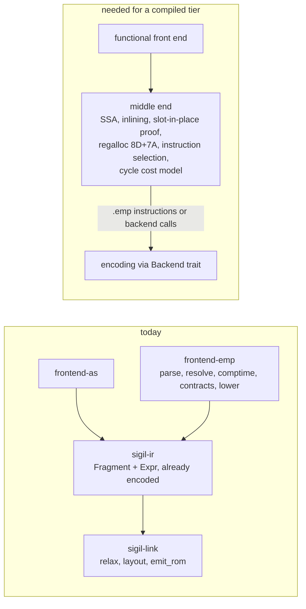

# Sigil assembler: research (sections 3 and 4)

Written 2026-11-16 against sigil `7630ba0d` and aeon `936439fa` (the commits the inventory pinned). Inputs: [[0-inventory]], the v2 [[AUDIT_TEMPLATE]], [[Audit process review]], [[Audit board]], `empyrean/docs/ASSEMBLER_VISION.md`, `empyrean/docs/SIGIL_IDEAS_FUNCTIONAL_TIER.md`, `empyrean/docs/ROADMAP.md`, the S.C.E. build scripts, the Oracle symbol loader, and the web sources listed at the end. Two small measurements were run in this stage (asl and Sigil on a scratch copy of S.C.E.); they are labelled MEASURED and described in "Measurements made in this stage".

> [!verdict] Research position (input for the reviewers, not the verdict)
> | Axis | Best known (who) | Sigil today | Where Sigil sits |
> |---|---|---|---|
> | Encoding correctness and test rigour | Sigil's own gates: frozen `asl` ISA vectors, Capstone differentials, in-process determinism check | 329 frozen vectors, 3 Capstone test files, 5,870 listed tests (inventory §6) | **Best known** for the ISA layer. **Weaker for whole-ROM bytes**: no independent oracle since `asl` left (inventory headline) |
> | Branch relaxation | LLVM MC `relaxOnce` fixpoint; vasm (pass cap 1,500) | Grow-only rung-ladder fixpoint with a proven pass cap and a non-convergence report (`relax.rs:1-19`, `:1068-1077`) | **On par** with LLVM MC; stronger termination argument than vasm or AS |
> | In-language verification (register contracts, flag checks, cycle budgets) | None of the tools surveyed here offer it in the manuals I read (AS, vasm, RGBDS, ca65) | Shipped in the `.emp` front end | **Beyond** the assemblers surveyed (not a "nobody does this" claim; see 3.9) |
> | Debug info | ca65/ld65 `.dbg` (lines, spans, scopes, types; Mesen source view); vasm `-dwarf`; llvm/gcc ELF+DWARF via gdb (BlastEm has a gdb stub) | Symbols only: `.lst` symbol/equate/phase tables plus one fake body line per symbol for Oracle; deb2 appendix built by shelling out to `aeon/tools/convsym` (`native.rs:4809-4839`) | **Below the floor.** Even `asl -g` writes a line↔address MAP file, and the floor toolchain (S.C.E.: AS + convsym) gets the same deb2 appendix Sigil does |
> | Diagnostics | rustc / Elm model; ariadne/miette renderers; RGBDS 1.0 (`-W` groups, `-Werror=NAME`, `-B` backtrace depth) | `file(line):col: level: message`, code in the text, macro-expansion context in the AS front end, no snippet or caret, no secondary labels, warn tier controlled only by `SIGIL_WARNINGS` | **Above AS, below RGBDS and far below rustc.** The structured model the vision specifies (codes, secondary spans, fix-its) is ABSENT (`sigil-span/src/lib.rs:425-429`) |
> | Incremental builds | rust-analyzer/salsa (query graph, durability); Zig `-fincremental` (500K lines: 14 s → 63 ms, PUBLISHED) | None; cross-invocation caching ruled out on purpose (`resolve/mod.rs:80-86`) | **Below best known.** Fine for today's batch loop (1.15 s PUBLISHED), not enough for an LSP |
> | Editor / LSP | rust-analyzer; KickAssembler and RGBDS ecosystems have VS Code integrations | TextMate grammar only | **Below** every modern peer |
> | Speed (full build) | asl on S.C.E.: 0.22 s for a 436 KB ROM (MEASURED) | `sigil build` 1.15 s for an 845 KB ROM (PUBLISHED, `build.sh:37-48`; includes comptime compression and contract checks asl never did) | **Adequate.** Not the bottleneck: the build-invoking gate lanes are 92% of `build.sh` wall time |
> | Generality (other AS sources) | asl itself; clownassembler (ASM68K clone, assembles the S1 asm68k disassembly) | Cannot assemble S.C.E.: 120 errors (`ifb`/`ifnb`, label-less `equ name,value`, `incfile.ba`, include search path, `@file` response files) (MEASURED) | **Aeon-shaped**, not an AS replacement. Relevant to "a second game sharing the engine" only if that game brings AS sources |
> | Hosting a compiled functional tier | LLVM (experimental M68k backend; no upstream Z80); llvm-mos for a model of a retro LLVM target with DWARF | IR is post-selection fragments (`Data`, `Fill`, `Reserve`, three relax kinds, `Org`) over `Int/Sym/Binary/Unary` exprs; no SSA, no register allocator (inventory §3) | **Not ready.** A tier could lower to `.emp` instructions and reuse everything from encoding down, but the middle end would be new work. Cranelift has no 68000 or Z80 backend |
>
> **The one-line read:** Sigil's verification story is ahead of every assembler surveyed; its debug-info, diagnostics and incremental/LSP stories are behind the 2026 vision document that justified writing it, and on debug info it is behind the AS toolchain it replaced.

## 3. Best known approach

The template's slots, mapped to a toolchain: **floor** = the AS toolchain the Sonic disassemblies and S.C.E. use; **commercial** = SN Systems' SNASM68K/ASM68K (the Psy-Q line, used for Sonic-era and later Genesis titles) and the gcc/SGDK line (the standard for modern commercial homebrew such as the titles named in aeon's CLAUDE.md); **best homebrew** = vasm (Amiga scene and Genesis homebrew, 68000 and Z80 in one core); **demoscene / other 8-bit** = ca65/ld65, RGBDS, 64tass, KickAssembler; **modern, outside the Genesis** = LLVM MC, salsa/rust-analyzer, Zig incremental, Cranelift, llvm-mos.

### 3.1 The floor: AS (asl) + p2bin + convsym (S.C.E., skdisasm, s2disasm)

**How it works.** S.C.E.'s `build.sh` runs `asl @asflags Engine/Includes.asm` (flags `-cpu 68000 -xx -n -q -c -A -L -OLIST S3CE.lst -o S3CE.p -shareout S3CE.h -U -E S3CE.log -i .`), then `p2bin -p=FF -z=0,kosinskiplus,…` (the Z80 driver is compressed at link time), then `convsym S3CE.lst S3CE.gen -input as_lst … -a` to append a symbol table for the in-ROM error handler, then `convsym … -out asm` to export RAM symbols, then `fixheader` (`Sonic-Clean-Engine-S.C.E.-/build.sh:13-36`). Five separate tools; state passes through files.

**What AS offers that matters here** (AS manual V1.42, PUBLISHED):
- **Debug info:** `-g [MAP|Atmel|NoICE]` writes "a symbol table and a table describing the assignment of source lines to machine addresses". That is a line table. Sigil has none (inventory claim 11).
- **Multi-pass:** "From version 1.38 on, AS is a multipass-assembler"; `-r [n]` warns when something forces another pass. No proven termination bound.
- **Diagnostics:** one line per message; `-gnuerrors` gives GCC-like positions "but precise error positions in macro bodies are not shown"; `-n` adds error numbers.

**Speed.** asl on S.C.E.: **0.219 to 0.228 s** wall over 3 runs, producing a 439,197-byte `.p`, a 5.57 MB listing and a 435,778-byte ROM after p2bin (MEASURED; see the measurement section for context).

**Where it breaks.** Single maintainer; no modules or types; errors point into macro expansions; no editor tooling. Sigil already beats it on every one of these except debug info and raw speed.

> [!finding] F-R1. Sigil emits less debug information than the toolchain it replaced
> `asl -g` gives a line↔address table; vasm gives DWARF (3.3); Sigil's listing is symbol, equate and phase tables plus one synthetic `(0) n/ADDR : Name:` body line per symbol so Oracle's parser accepts it (`sigil-link/src/listing.rs:145-175`). Oracle therefore resolves addresses by nearest-preceding symbol (`oracle-core/src/symbols.rs:457`), the exact limitation `ASSEMBLER_VISION.md:152` set out to remove. Whether Aeon's old asl build passed `-g` was not checked; either way the capability gap stands.

### 3.2 Commercial: SN Systems SNASM68K / ASM68K, and clownassembler

**How it worked.** SNASM68K paired with a target box and the SNBUG68K debugger; its `sdb` option put "source debug info in the COFF file for source debugging with the SNBUG68K debugger. Not compatible with emulators", and `/p` produced the flat binary "required for use with emulators and final ROMs, omit for use with SNBUG68K" (Sega Retro SNASM68K page, as quoted in search results; the page itself was blocked by a bot wall when fetched, so this is PUBLISHED at second hand). ASM68K is the later, command-line descendant used by the Hivebrain-era Sonic 1 disassemblies (`asm68k /o op+ /o os+ /o ow+ /o oz+ /o oaq+ /o osq+ /o omq+ /p /o ae- …`, Sonic Retro guide).

**What it did better.** 1990s commercial developers had **source-level debugging on real hardware**. The suite has an emulator it controls, so it can do better than that, but does not yet do as well.

**clownassembler** (Clownacy, C89, AGPL-3.0) is an open ASM68K clone that assembles the Sonic 1 Git disassembly's asm68k branch and the S2 Nick Arcade disassembly; its author has said AS compatibility is a later goal (GitHub README and Sonic Retro forum, PUBLISHED). It is the nearest existing proof that a clean-room Sonic-community assembler can reach "drop-in" on a corpus that did not grow up next to it, which is exactly the anti-overfit test `SIGIL_IDEAS_FUNCTIONAL_TIER.md` proposes for Sigil (s1disasm) and which Sigil has not passed (F-R2).

### 3.3 Best homebrew: vasm (and the vbcc pairing)

**How it works.** One portable core, pluggable CPU modules (68000, Z80 and many more), syntax modules and output modules: ELF, a.out, COFF, TOS, Hunk, X68k, o65, vobj, binary, S-record, Intel hex and others (vasm manual chapter list, PUBLISHED). It has object files and a linker (vlink), so separate assembly is possible.

**Relevant features (vasm manual, PUBLISHED):**
- `-dwarf[=<version>]`: "Automatically generate DWARF debugging sections, suitable for source level debugging"; default DWARF V3 (added in 1.8e, 2018).
- `-maxpasses`: "Adjusts the maximum number of passes while resolving a section. Defaults to 1500"; error 8 is "cannot resolve section <%s>, maximum number of passes reached".
- `-depend` prints the dependency list (build-system integration); `-wfail` makes warnings fail.
- Errors are a numbered catalogue ("23: undefined symbol <%s>").

**Against Sigil.** vasm wins on debug output, object files and target breadth. Sigil wins on relaxation termination (a proven bound instead of a 1,500-pass cap), types, contracts and diagnostics content. `ASSEMBLER_VISION.md:94` already chose "steal its architecture, not its codebase"; this research does not change that.

### 3.4 ca65 / ld65 (cc65): the best debug-info story in the retro world

**How it works.** `ca65 -g` (or `.debuginfo on`) records debug data in objects; `ld65 --dbgfile` writes a `.dbg` text file whose header counts `csym, file, lib, line, mod, scope, seg, span, sym, type` records; a span is `span id, seg, start, size`, and scopes carry a parent, a kind (module, scope, struct, enum) and a size (`ld65/dbgfile.c`, `span.c`, `scopes.c`, PUBLISHED via the cc65 source). VICE labels come from `ld65 -Ln`.

**Consumer.** Mesen imports the `.dbg`, auto-loads it beside the ROM when the base names match, and adds a **source view** that steps through original files instead of disassembly, for assembly and C alike (mesen.ca debugger-integration docs, PUBLISHED). Its author describes the parser as "a bunch of regexes" that "only supports what I actually needed": a text format with a narrow reader was enough to give a whole community source-level debugging.

**Against Sigil.** This is the model the vision cites (`ASSEMBLER_VISION.md:151-157`). Spans keyed to segments rather than absolute addresses also answer the stale-symbol problem the ROADMAP records ("+$24 drift", `ROADMAP.md` build.json item), which Sigil has not shipped.

### 3.5 RGBDS (Game Boy): the best diagnostics among retro assemblers

**How it works.** `rgbasm` → object → `rgblink` (`-n` .sym, `-m` .map). Emulators (BGB, SameBoy, Emulicious) load `<rom>.sym` from beside the ROM (gbdev tutorial, PUBLISHED).

**Diagnostics (rgbasm man page and 1.0.0 release notes, PUBLISHED).** Warnings are named groups: `-Wall`, `-Weverything`, `-Werror`, `-Werror=NAME`, `-Wno-error=NAME`, and `OPT -Wno-…` in source. Errors carry an include/macro **location backtrace** (`audio.asm(1) -> constants.asm(5) -> macros.asm(1) -> macros/const.asm(3)`), with `-B` controlling depth. RGBDS 1.0.0 commits to semantic versioning.

**Against Sigil.** Sigil has codes (`[area.name]`, 284 literals) but no command-line or in-source level control except a global `SIGIL_WARNINGS=off|summary|full` (`sigil-cli/src/main.rs:185`, `:2903-2915`). Its AS front end prints macro context (`Load Objects.asm(310) Create_New_Object_4(2):5:`, seen in the S.C.E. run), which is roughly RGBDS-level. Its `.emp` diagnostics have no backtrace through comptime evaluation that I found.

### 3.6 64tass and KickAssembler (C64 demoscene)

- **64tass** is "a multi-pass optimizing macro assembler for the 65xx series" (manual v1.60, PUBLISHED); it exports VICE labels (`--vice-labels`) and listings with `--line-numbers`. A line-number listing bug was reported and fixed (SourceForge activity, PUBLISHED). Nothing here beats Sigil except label export for a third-party debugger.
- **KickAssembler** adds a full scripting language at assemble time (the closest analogue to `.emp` comptime) and `-debugdump`, which C64 Debugger and IceBro read for **source-level debugging**; the `.dbg` maps byte ranges to source line ranges per segment (C64Studio issue #70 sample; IceBro docs, PUBLISHED). The demoscene's lesson matches ca65's: a simple byte-range→source-range table is what makes a debugger useful.

### 3.7 SGDK / gcc and the gdb route on the Genesis

SGDK builds with `m68k-elf-gcc`; with `-ggdb` and the ELF kept, "you'll have full source-level debugging" in gdb against BlastEm's remote stub (`blastem rom.bin -D`; BlastEm waits for a connection; breakpoints, memory and registers worked, single-step was unfinished at the time of the post; `gdb_remote.c` was still being changed in March 2025) (SpritesMind BlastEm thread and retrodev repository, PUBLISHED). **This means an ELF+DWARF export from Sigil would give source-level debugging in BlastEm + gdb (and any gdb front end, including VS Code) for free**, as a secondary path beside Oracle.

**Other Genesis debuggers, as consumers.** MAME's debugger has symbol tables (`symlist`) and a Lua API that can add symbols (`symbols:add(name, value)`), but I found no command that loads a symbol file (MAME docs, PUBLISHED). I did not verify symbol-file support in Exodus or Gens KMod; no verdict depends on them, because Oracle is the suite's debugger and reads Sigil's `.lst` (`oracle-aether/src/main.rs:156`, `oracle-core/src/symbols.rs`).

### 3.8 Modern infrastructure outside the Genesis

| Idea | How it works (source) | What it means for Sigil |
|---|---|---|
| **LLVM MC layout** | `MCAssembler::layout()` loops `while ((FirstStable = relaxOnce(FirstStable)) > 0)`; fragments are re-sized in a forward sweep; a per-section cap (`Iters > … getLayoutOrder()`) breaks without an error; monotone growth is enforced for some fragment kinds only (`llvm/lib/MC/MCAssembler.cpp`, main, PUBLISHED) | Sigil's design is the same shape (fragments, fixups, fixpoint) and **stricter**: grow-only for every relaxable fragment, a proven cap, and a loud non-convergence report. Sigil lacks MC's dual-sink streamer (object file or text) and object files in general |
| **salsa / rust-analyzer** | Incremental query graph; **durability** lets salsa "skip traversing their dependencies" when no high-durability input changed (salsa book, PUBLISHED); the vision corrects the level count to four, `LOW/MEDIUM/HIGH/NEVER_CHANGE` (`ASSEMBLER_VISION.md:148`, `:296`) | The vision's tooling pillar is "a rust-analyzer clone" with salsa at the core (`ASSEMBLER_VISION.md:98`, `:146-150`). **Nothing of it exists** (no salsa in `Cargo.lock`, inventory §2). The code chose the opposite on purpose: a per-build memo only, because a cache that outlives a build "would produce a WRONG ROM THAT PASSES" (`resolve/mod.rs:80-86`). That argument is about a hand-rolled, name-keyed cache; salsa's revision tracking is the standard answer to it, so the two positions are not actually in conflict |
| **Zig incremental + self-hosted linker** | `-fincremental --watch`; one cited case, a 500,000-line codebase from about 14 s to 63 ms (0.14 release coverage, PUBLISHED); 0.15 still rebuilt whole modules for Ghostty (Hashimoto, PUBLISHED); the new ELF linker in 0.16.0 gives millisecond rebuilds on x86_64 Linux (Zig devlog, 2026-05-30, PUBLISHED) | Proves sub-100 ms edit-to-binary is reachable for a whole-program compiler that patches its output in place. A Genesis ROM is a single flat image with no dynamic linking, which is the easy case for in-place patching, **provided relaxation does not move everything**: an edit that grows one fragment shifts every later address. Hence the vision's "firewall" (`ASSEMBLER_VISION.md:148`, `:282`) |
| **Cranelift** | Four backends only: "x86-64, aarch64 (aka ARM64), s390x (aka IBM Z) and riscv64" (Cranelift README, PUBLISHED) | Not a host for a 68000/Z80 functional tier |
| **LLVM M68k** | Experimental target; buildbot moved to production in January 2023; Rust gained `m68k-unknown-none-elf` in 2025 (minimum CPU M68010 at the time); compiler-rt builtins for bare-metal M68k merged 2025-11-24; open items include 32-bit relocations and `-mxgot` (LLVM lists, Rust PRs, PUBLISHED) | A possible backend for a functional tier on the 68000 side only, with no published code-quality data and an M68010 floor in Rust's target at the time. No upstream Z80 |
| **llvm-mos** | An LLVM target for the 6502, a register-starved retro CPU (project site blocked the fetch with 403; DWARF output not verified here) | Proof that a real optimising middle end can target hostile 8-bit hardware; whether its debug story reaches emulators is unverified in this stage |

### 3.9 What Sigil does that the surveyed tools do not

Read from Sigil's source and the manuals cited above. **This is not a "nobody does this" claim**: I read the option and directive lists of AS, vasm and RGBDS, the cc65 debug-info sources and KickAssembler's integration docs, not every assembler.

- **Register `in`/`out`/`inout` contracts verified in production code on both CPUs, a flag checker, and per-routine cycle budgets** (`frontend-emp/src/flag_check.rs`, `cycle_budget.rs`, `z80_cycles.rs`, `preserves.rs`, `out_verify.rs`; inventory §1). None of the surveyed assemblers has these.
- **A whole-corpus contract-closure pass before linking** (`ROADMAP.md`, quoted in the inventory's §3 context).
- **Verification apparatus:** 329 frozen `asl` ISA vectors, Capstone differential gates, 62 `*_port` gates, 7 frozen whole-ROM goldens, an in-process determinism assertion ("a second build is byte-identical", `sigil-cli/tests/native_full_rom.rs:245-247`). No surveyed assembler documents anything comparable; I did not read their test trees, so this is a statement about documentation only.
- **A provable relaxation bound** (3.8, LLVM row).

## 4. Ceiling: what an ideal toolchain for this suite would do

There is no shared [[Hardware limits]] page yet (searched `aeon/docs` and `empyrean/docs`: no file). The hardware facts that bind a toolchain are few: the 68000 sees cartridge ROM at `$000000-$3FFFFF`, 4 MB (plutiedev memory map, PUBLISHED); beyond that a mapper is needed, and Sigil has none (`CARTRIDGE_SIZE = 0x40_0000`, `sigil-ir/src/map.rs:35`; grep `SSF2|mapper|bank_switch`: 0 hits, inventory headline). The named 4 MB workload therefore sits **exactly at 100% of the flat window**: it fits, with zero headroom. Everything else in this section is a software ceiling.

### 4.1 Targets

All targets are ESTIMATED unless labelled; derivations follow the table.

| Property | Ideal target | Best known evidence | Sigil today | Gap |
|---|---|---|---|---|
| Full clean build, Aeon today (845 KB ROM, 87K `.emp` lines) | ≤ 1 s release-profile binary on the 16-core box | asl: S.C.E. in 0.22 s (MEASURED) | 1.15 s (PUBLISHED, `build.sh:37-48`, 16 cores, load 7 to 9, DEBUG=1 shape) | About at target. Not the bottleneck (the gate lanes are 92% of a canonical build) |
| Full clean build, 4 MB TF4-scale ROM with a heavy Z80 driver | ≤ 3 s | — | Not measured; ESTIMATED 2 to 6 s (derivation a) | Unknown: stage 2 should build a synthetic 4 MB shape (`stress-art` exists) |
| Edit one object routine → new ROM | ≤ 100 ms | Zig 63 ms on 500K lines (PUBLISHED) | = full build, 1.15 s; `FAST=1` loop about 1.3 s (aeon `CLAUDE.md`) | 10× |
| Edit → diagnostics in editor | ≤ 50 ms per keystroke for the open file | rust-analyzer class | No LSP | Absent |
| Determinism | Bit-identical across runs, machines and OSes; hermetic inputs; a build id in the ROM's sidecar | Zig's hermetic comptime (vision §4b) | In-process two-build equality asserted (`native_full_rom.rs:245`). **Not hermetic:** `sigil build` writes generated sound files into the Aeon tree (`native.rs:836-857`), shells out to `convsym` (`native.rs:4821-4825`), uses temp dirs | Cross-machine reproducibility untested; build.json ABSENT |
| Symbol and debug export | Line table with `is_stmt`, ranges per macro/comptime expansion, typed struct layouts, scopes, RAM symbols per CPU address space, code/data map, build id; flat exporters (.sym/.mlb/convsym); optional ELF+DWARF for gdb/BlastEm | ca65 `.dbg` + Mesen; vasm `-dwarf`; `asl -g` | Symbols + equates + phases + Source Digest; deb2 via external convsym | Line table, types, scopes, build id ABSENT (inventory claims 11-12) |
| Diagnostics | Structured: stable code, primary + secondary spans, notes, help, machine-applicable fix-its, lint levels on the CLI and in source, backtrace through includes, macros and comptime; JSON output for the LSP and Oracle | rustc; RGBDS 1.0 for the retro subset | Code in text, one span, hand-rendered one-liners | Most of the model ABSENT |
| Language server | Diagnostics, go-to-definition, references, rename, hover; inlay hints for addresses, sizes, cycles and struct offsets (the core already computes them) | rust-analyzer; the vision's §4c list | None | Absent |
| Generality | Assembles at least one corpus it did not grow up with (s1disasm or S.C.E.) byte-identically | clownassembler on S1 asm68k | S.C.E.: 120 errors (MEASURED) | Large; matters only if the second game or community use brings AS sources |
| Compiled tier | IR with a middle end (SSA or similar), register allocation for 8 D + 7 A registers, guaranteed in-place slot mutation, cycle cost feedback into the same budgets | LLVM M68k (experimental); llvm-mos model | Encoding-level IR only | The whole middle end |

**Derivations.**
- (a) 4 MB build time. Throughput today is about 87,259 `.emp` lines in 1.15 s, about 76K lines/s (PUBLISHED time, MEASURED line count, ESTIMATED rate). A TF4-scale game is mostly data, not code: if code doubles to about 175K lines and data is `incbin`/comptime-compressed, front-end time roughly doubles to about 2.3 s; the rest depends on how much compression runs at build time (Sigil runs ZX0/S4LZ/clownlzss in-process, which asl never did). Range 2 to 6 s. The derivation depends on an unmeasured split between front-end and compression time; stage 2 should measure it.
- asl comparison: S.C.E. has 51,752 lines in `.asm` files on disk (MEASURED, all files, not only those included), so asl's rate is at most about 235K lines/s (ESTIMATED upper bound). The two numbers are not like-for-like: S.C.E. ships pre-compressed art and has no contract checks.
- 100 ms incremental: a Genesis ROM is one flat image; the work after an edit is re-lower one module, re-relax its section, re-place if its size changed, re-emit. With a section firewall (sizes and exports stable), that is one module's front end (about 87K/207 ≈ 420 lines per file on average, under 10 ms at today's rate) plus a re-link of fragment lists. ESTIMATED, assuming the firewall holds.

### 4.2 Architecture fit for a compiled functional tier

Answering the scope question "could it host a compiled functional tier?", using the language audit's open options (functional for logic only, or functional everywhere):

- **What carries over unchanged:** the `Backend` trait and encoders (`sigil-ir/src/backend.rs:42`), relaxation and linking, the cycle tables (`sigil-isa`), the contract and cycle-budget checkers (they can check compiler output the same way they check hand-written code), the golden and Capstone gates.
- **What is missing:** everything between a typed AST and instruction choice. `sigil-ir` is an encoding-level IR: `Fragment::Data` holds bytes already chosen. That is the right IR for an assembler and the wrong one for an optimiser; a compiled tier needs its own IR above it, which is what `SIGIL_IDEAS_FUNCTIONAL_TIER.md` already assumes ("a third front-end lowering into the same IR").
- **The cheapest viable route:** lower the functional tier to `.emp` instructions (text or AST), so the existing contract, flag and cycle checkers judge the output. This is how the ideas note's PitcherPlant example would work: match arms become the routine-dispatch table the engine already uses.
- **Off-the-shelf backends do not fit the Z80 side at all** (no Cranelift target; no upstream LLVM Z80) and fit the 68000 side only experimentally (LLVM M68k, no published code-quality numbers). "Functional everywhere" including the Z80 driver would mean writing a Z80 code generator in-house.

## Measurements made in this stage

> [!note] Context for every timing below
> Machine: 16 cores, shared with other audit agents (load average 10.6 to 13.1 at the start of the runs, `uptime`). Wall clock by Python `time.perf_counter()` around `subprocess.run`. Scratch copy of S.C.E. at `d2f1988` (2026-04-30) under `scratchpad/audit-builds/research-sce`; nothing was written to any repo. Sigil binary: the inventory's release build of `7630ba0d` (`scratchpad/audit-builds/sigil-inv/release/sigil`, release profile).

| What | Result | Label |
|---|---|---|
| `asl @asflags Engine/Includes.asm`, S.C.E., 3 runs | 0.224 / 0.219 / 0.228 s, exit 0; `.p` 439,197 B, `.lst` 5,574,602 B; after `p2bin`, ROM 435,778 B | MEASURED |
| `sigil` as `asl` (symlink), same flags via `@asflags` | Refused: "a second source file … sigil run as asl assembles one source per call" (no `@file` response files) | MEASURED |
| `sigil` as `asl` with the flags spelled out | Refused `-i .`: "sigil resolves `include` against the source file's directory … and searches no other" | MEASURED |
| `sigil _root.asm -o … -p=FF` with a root wrapper `cpu 68000` + `include "Engine/Includes.asm"` | Exit 1 in 0.558 s: **120 errors, 1 note**, front end only. Top causes: `endif` 27, `ifnb` 24, `else` 19 (all follow the unsupported `ifb`/`ifnb`), bad operand expression 16, `ifb` 4, `incfile.ba` 4, bad byte expression 4, label-less `equ NAME,value` 2 (`DMA Queue.asm:178`), plus unresolved symbols downstream | MEASURED |

> [!finding] F-R2. Sigil's AS front end is fitted to Aeon, not to AS
> The S.C.E. run fails on ordinary AS forms (`ifb`/`ifnb`, `equ` with the name as an operand, include search paths, response files). This does not touch Aeon's build (Aeon has 899 lines of residual `.asm`, inventory §3), but it bears on two scope items: the "AS compat as adoption wedge" idea in `SIGIL_IDEAS_FUNCTIONAL_TIER.md`, and the claim that there is no independent whole-ROM oracle (an S.C.E. or s1disasm byte-identity gate against the bundled `asl` would be one).

## Blocked or not done

- **vasm, ca65, RGBDS, 64tass, KickAssembler were not run**: none is installed (`command -v`: no hits) and installing tools was out of scope for a read-only research stage. Their entries rest on manuals and sources (PUBLISHED).
- **vasm's own site** refused the connection; the manual was read from the `mbitsnbites/vasm-mirror` copy of `doc/vasm_main.texi`.
- **Sega Retro** (SNASM68K) returned a bot wall; that entry relies on the search engine's quotation of the page.
- **llvm-mos.org** returned 403; its DWARF/emulator story is unverified and no verdict here depends on it.
- **Exodus and Gens KMod symbol loading**: not verified; not a verdict input (3.7).
- **The Sigil test suite** was not run (stage 2's job; inventory §6 records it as DID NOT RUN).

## Sources

Local (read at the commits named at the top): `Sonic-Clean-Engine-S.C.E.-/build.sh`, `Tools/AS/Linux/asflags`; `sigil/crates/sigil-link/src/{relax.rs,listing.rs}`; `sigil-harness/src/native.rs:836-857, 4809-4839`; `sigil-frontend-emp/src/resolve/mod.rs:60-110`; `sigil-cli/src/main.rs:185, 750-800, 2903-2915`; `sigil-cli/tests/native_full_rom.rs:245-247`; `sigil-span/src/lib.rs:321, 425-429`; `oracle/crates/oracle-core/src/symbols.rs`; `oracle/crates/oracle-aether/src/main.rs:156`; `empyrean/docs/ASSEMBLER_VISION.md`; `empyrean/docs/ROADMAP.md:370-420`; `empyrean/docs/SIGIL_IDEAS_FUNCTIONAL_TIER.md`; `aeon/build.sh:30-60`.

Web:
- [AS manual V1.42 (mirror)](https://ubuntourist.codeberg.page/Altair-8800/_static/as_EN.html); [asl.1 man page](https://cgit.osmocom.org/dect/asl/tree/asl.1)
- [vasm manual source, vasm_main.texi (mirror)](https://raw.githubusercontent.com/mbitsnbites/vasm-mirror/master/doc/vasm_main.texi); [vasm manual index (mirror)](https://raw.githubusercontent.com/mbitsnbites/vasm-mirror/master/doc/vasm.texi); [vasm history, -dwarf in 1.8e](https://git.applefritter.com/Macintosh-SW/NetBoot/src/branch/master/vasm-1/history)
- [SNASM68K, Sega Retro](https://segaretro.org/SNASM68K); [Hivebrain to ASM68K guide](https://dcmpx.remotevs.com/org/sonicretro/info/PL/SCHG_How-to:Convert_the_Hivebrain_2005_disassembly_to_ASM68K); [clownassembler README](https://github.com/Clownacy/clownassembler/blob/master/README.md); [Sonic Retro forum post on clownassembler](https://forums.sonicretro.org/posts/1098516)
- [cc65 debugging](https://cc65.github.io/doc/debugging.html); [ld65 dbgfile.c](https://git.applefritter.com/6502/cc65/src/branch/master/src/ld65/dbgfile.c); [ld65 span.c](https://git.applefritter.com/6502/cc65/src/branch/master/src/ld65/span.c); [ld65 scopes.c](https://git.applefritter.com/6502/cc65/src/branch/master/src/ld65/scopes.c); [Mesen: integration with CC65/ASM6](https://mesen.ca/docs/debugging/debuggerintegration.html); [Mesen .dbg parser remark](https://nesdev.nes.science/f3/t15155.xhtml)
- [rgbasm(1), RGBDS 1.0.0](https://manpages.ubuntu.com/manpages/resolute/man1/rgbasm.1.html); [RGBDS releases](https://www.github.com/rednex/rgbds/releases); [RGBDS 1.0.0-rc1 notes](https://newreleases.io/project/github/gbdev/rgbds/release/v1.0.0-rc1); [backtrace example](https://www.pokecommunity.com/threads/pokemon-red-blue-full-color-hack-rb-remade-for-gbc.361713/post-10917780); [gbdev tutorial, .sym](https://gbdev.io/gb-asm-tutorial/part1/tracing)
- [64tass manual](https://tass64.sourceforge.net/); [64tass usage](https://aminet.net/package/dev/cross/64tass); [64tass activity](https://sourceforge.net/p/tass64/activity); [C64Studio issue 70 (KickAss .dbg)](https://github.com/georgrottensteiner/c64studio/issues/70); [IceBro](https://github.com/sakrac/icebro); [c64jasm debug info](https://nurpax.github.io/posts/2021-02-22-c64jasm-debug-info.html)
- [BlastEm gdb thread](https://gendev.spritesmind.net/forum/viewtopic.php?p=21382); [BlastEm gdb_remote.c](https://www.retrodev.com/repos/blastem/file/tip/gdb_remote.c?revcount=2); [SGDK gdb page](https://gendev.spritesmind.net/page-gdb.html); [MAME debugger docs](https://git.redump.net/mame/plain/docs/source/debugger/general.rst?h=mame0226); [MAME Lua debugger classes](https://docs.mamedev.org/luascript/ref-debugger.html)
- [LLVM MCAssembler.cpp](https://raw.githubusercontent.com/llvm/llvm-project/main/llvm/lib/MC/MCAssembler.cpp); [salsa durability](https://salsa-rs.github.io/salsa/reference/durability.html); [Zig 0.14 release notes](https://ziglang.org/download/0.14.0/release-notes.html); [Zig 0.14 incremental coverage](https://daily.dev/blog/zig-announces-version-0140/); [Hashimoto on Zig builds](https://mitchellh.com/writing/zig-builds-getting-faster); [Zig ELF linker devlog](https://ziggit.dev/t/devlog-elf-linker-improvements/15808); [Cranelift README](https://raw.githubusercontent.com/bytecodealliance/wasmtime/main/cranelift/README.md)
- [LLVM M68k ready to land](https://discourse.llvm.org/t/m68k-new-experimental-target-m68k-is-ready-to-land/57815); [M68k buildbot to production](https://lore.kernel.org/all/730dab34-7638-9bb2-e3a6-89492b782995@physik.fu-berlin.de/T/); [Rust m68k-unknown-none-elf PR](https://redirect.github.com/rust-lang/rust/pull/135085); [Rust m68k PR 144640](https://github.com/rust-lang/rust/pull/144640); [compiler-rt M68k builtins](https://lists.llvm.org/pipermail/llvm-commits/Week-of-Mon-20251117/1783549.html); [M68k 32-bit relocations RFH](https://discourse.llvm.org/t/rfh-m68k-implementing-support-for-32-bit-relocations/90660)
- [plutiedev memory map](https://plutiedev.com/memory-map)
