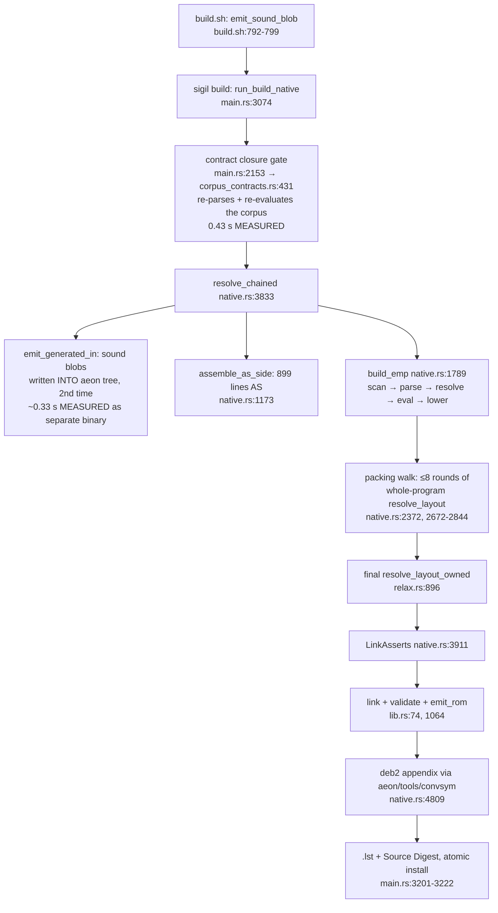

# Sigil assembler: reviewer A

Sigil `7630ba0d`, aeon `936439fa` (a `git archive` copy in scratch). Sections 1, 6, 7 and 8, the mandatory walk A (one `.emp` file from source to ROM bytes), a coverage table and challenges. Written 2026-11-16. I did not read reviewer B, the checker or any earlier review.

> [!verdict] Verdict and disposition
> **On par with the best common tools overall.** Beyond them on in-language verification (register contracts, flag checks, cycle budgets, link-time `ensure`). Below them on debug info, diagnostics presentation, and on being a toolchain a second game can use without editing the toolchain. ~~One real correctness hole (F1).~~ *(Corrected in the checker round:)* Two real correctness holes: F1 (immediate truncation) and F9 (a section can overflow its named region and still reach the ROM; a known, open queue row). CI on master has been red since 2026-09-28 (F10).
>
> **Disposition: keep the core and patch it; rewrite the build driver beside it.** The ISA layer, IR, linker relaxation and `.emp` front end are sound and well tested. The part that is wrong in shape is the `sigil-harness` native driver (`native.rs`, 7,396 lines). It holds the game's knowledge in Rust: per-game profiles, 108 section-alignment rows, 7 frozen address tables, a hard-coded helper-module list, and bespoke sound "seams". It also wraps the proven linker fixpoint in an unproven 8-round placement loop. Rewrite that driver natively (game data in aeon, placement in `sigil-link`), with the current driver as the byte oracle.
>
> **Could it host a compiled functional tier?** Yes, at the `CodeBuf` level, not at `sigil-ir`. Fix three things first: quadratic per-module evaluation (F4), per-call thread spawns, and the missing line table (F6).

## Walk A: one file from source to ROM bytes

**The file:** `aeon/engine/system/dma_queue.emp` (657 lines, read in full). It is a mid-size engine module that uses most of the language: `use` imports, `const` derived from `sizeof`/`offsetof`, four `comptime fn`s that return `Code`, a `fold` over a range, contracts (`clobbers`, `out(carry:)`, `preserves(sr.mask)`, `inout` callers), `requires(vblank)`, `@budget(cycles: 670)`, a computed `jmp` with `targets(...)`, `if DEBUG == 1` arms, unsized branches and `jbra`, and four `ensure(extern(...))` link-time guards.

**The build:** the release `sigil` binary from stage 0, run as `sigil build --aeon . --native --game sonic4 -o s4.bin --emit-lst s4.lst` in my scratch copy. Exit 0, `crc=193507d9 len=850296`, which is the length stage 2 measured for HEAD. MEASURED.

| # | Stage | Where (file:line) | What happens to `dma_queue.emp` | Errors caught here | What can slip through | Cost |
|---|---|---|---|---|---|---|
| 0 | Pre-step: sound emit | `aeon/build.sh:792-799`; again in `native.rs:3834` → `:839-857` | Not this file. The Z80 blobs are linked by Rust "seams" and written to `engine/sound/generated/` | Seam link errors | Done twice per `build.sh` run (F8) | 0.33 s per emit (MEASURED, separate binary, release, load 7-12) |
| 1 | Contract closure gate (before the build) | `main.rs:3080` → `:2153`; `corpus_contracts.rs:431-504` | Parsed and every proc body **evaluated a second time**, against a flat whole-corpus declaration list (`collect_env`, `:1943-1968`), not this file's `use` imports | Undeclared clobbers across calls, `out`/`inout` honesty, context escapes, D1c live-clobbers. An injected `moveq #0,d2` in `Init_DMA_Queue` gave exit 1 (MEASURED) | The error says "1 firing(s)" with **no proc name or location** (F3). It analyses a differently resolved program from the one shipped (F2) | 0.43 s of 2.87 s, 15% (MEASURED: median 2.875 s against 2.440 s with `SIGIL_CONTRACTS=0`, 5 runs each) |
| 2 | Manifest scan, lex, parse | `resolve/manifest.rs:50-120`; `lib.rs:42-50`; `lexer.rs:78`; `parser.rs:3231-3366` (`instr_line`) | All 207+ `.emp` files under the aeon root are parsed, including `tools/fixtures`. Instructions parse as mnemonic + operands; a size suffix must touch the mnemonic, so `.full` after whitespace is a label | Lex errors (bad literals, `i64` overflow `lexer.rs:206-236`), syntax errors with recovery | Mnemonic validity is not checked here (it is checked at lowering) | Not separable (no profiler: BLOCKED) |
| 3 | Name resolution | `native.rs:1800-1820` (`COMPTIME_HELPERS`, `rewrite_helper_imports`); `resolve/mod.rs` (`build_program_open_embed_counted`) | `use engine.structs.{DMAEntry}` etc. resolve. Twelve "helper" modules are glob-imported into every module by a **list hard-coded in Sigil**, and "the later helper silently wins a duplicate name" (~~`native.rs:1814-1816`~~ `native.rs:1819`, list at `:1802`; *line corrected in the checker round*) | Unknown names, duplicate module ids | A same-named item in two helpers resolves silently to the later one (an aeon Python tool gates it, not Sigil) | Not separable |
| 4 | Comptime | `eval/mod.rs:2050-2118` (`eval_proc_body_full`, on a fresh 64 MiB thread, `:1924-1941`); `eval/asm.rs:150-300` | `ENTRY_LEN` etc. fold. `fill_slot_markers(DMA_TOTAL_SLOTS)` folds 32 iterations into 64 instructions. `jt_slot(.drain_k)` splices with label hygiene. `ensure(sizeof(DMAEntry) == 14)` is decided. The module-level `ensure(extern(...))` lines become `LinkAssert`s | Failed `ensure`, recursion depth, division by zero, unknown local label (`asm.rs:178-191`), and "instruction dropped" (`asm.rs:255-270`) | Typed `const X: u8 = 300` is accepted: `const_arity.rs:105-107` checks only array arity (F1) | Each `Evaluator` re-indexes the whole file (`eval/mod.rs:848-849`), once per proc and data item: quadratic in items per module (F4) |
| 5 | Contract checking (per file) | `lower/proc.rs` `lower_proc`: `check_clobbers`, `check_preserves`, `check_out`, `check_context_brackets`, `check_stack_balance`, `check_cycle_budget` | `@budget(cycles: 670)` on `Process_DMA_Critical` is walked over the evaluated `CodeBuf`, charging every relaxable operand its `abs.l` ceiling. `requires(vblank)`, `preserves(sr.mask)` through the `jbra` tail | Over-budget cycles, preserves violations (errors) | The per-file clobber lint is a **warning** and produces 63 false positives on this corpus, e.g. `PageCache_PatchRun_Seq` saves d1-d5/a2-a4 with `movem` and is still flagged (MEASURED). The closure gate (stage 1) is the real gate | Not separable |
| 6 | Instruction selection and encoding | `lower/code.rs:188-360` (`lower_m68k_instr`); `:1388-1470` (`m68k_operand`); `sigil-backend-m68k/src/lib.rs:43-47`; `sigil-isa/src/m68k.rs:256` | The mnemonic is encoded as written (plus `cmp→cmpi` refinement, `(0,An)→(An)`). `move.w #DMA_Critical_End,d4` becomes an `ImmWord16Be` fixup. `lea DMA_Queue,a0` becomes `RelaxAbsSym`. `beq .full` (unsized) becomes a `.s/.w` ladder. `jmp .jump_table(a1)` is a `d16(An)` with an `Abs16Be` fixup | Displacement, abs.w, Z80 immediates, quick-immediate counts, illegal EAs | **Eager immediates are not range-checked** at any layer (F1) | Not separable |
| 7 | Relaxation and placement | `native.rs:2372-2410`, `:2672-2844` (outer packing walk, ≤ 8 rounds); `sigil-link/src/relax.rs:952-1200` (inner fixpoint) | The section packs after its map-order predecessor. Widths settle: `jbra` → `6012` (`bra.s`); `lea DMA_Queue` → abs.w | Out-of-reach branches, overlap, island reclassification | The outer loop is not grow-only and has a fixed 8-round cap that ends in "relaxation oscillation, hand ruling needed" (F5). Spans use a heuristic `gap <= im + 0x10` (`native.rs:2959`) | Several whole-program `resolve_layout` calls per build (ESTIMATED from the call graph). Resolve to `--check` took 2.26 s in total (MEASURED, median of 5) |
| 8 | Link-time guards | `native.rs:3911-3925`; `sigil-link/src/lib.rs:390/440` | The four `ensure(extern("DMA_*") …)` geometry pins decided against final RAM addresses. 698 LinkAsserts and 89,905 comptime `ensure` verdicts in this build (MEASURED from `--check` output) | RAM layout drift | Nothing found | Inside 2.26 s |
| 9 | Link and fixups | `sigil-link/src/lib.rs:74-130` (symbol table), `:640-900` (`apply_fixup`) | `ImmWord16Be` writes `80BA` for `$FFFF80BA`, high half `FFFF` accepted. `Abs16Be` writes `1E7E` for the jump table | Every link-time kind is range-checked (`:735-750`, `:752-775`, `:783-829`, `:855-870`) | A duplicate symbol is reported with a **null span** (`lib.rs:86-91`, a TODO) | About 0.2 s together with stages 10-12 (ESTIMATED: 2.44 s without the gate minus 2.26 s for `--check`) |
| 10 | Output | `sigil-link/src/lib.rs:1042-1070` (`emit_rom`: map validation, flatten, checksum) | Bytes land at their LMA. The checksum is folded | Section outside every ROM region, overlap | ~~—~~ *(checker round)* An overflow of a named region nested inside the whole-cart `rom` region, or a spill that starts at the next region's base: only the first ROM region holding the LMA is checked (F9) | Inside the 0.2 s |
| 11 | deb2 appendix | `native.rs:4809-4917` | The symbol listing is written to a temp dir, `aeon/tools/convsym` is spawned, the ROM is re-read, and `$1A4` and the checksum are re-fixed | Missing magic, size outside the band | **No check that the appended file still fits 4 MB**. The band is capped at 64 KB (F7) | Inside the 0.2 s |
| 12 | Symbols and listing | `main.rs:3201-3222`; `sigil-link/src/listing.rs:145-200` | `Init_DMA_Queue` at `$1C7A`; locals appear mangled (`$engine.dma_queue$QueueDMA_Deferrable$full`) | — | **No address→`file:line` rows**, though every `DataFragment` carries its source span (F6) | Inside the 0.2 s |

**The bytes, checked against the source** (MEASURED with `xxd` on my `s4.bin`):
- `QueueDMA_Critical` at `$1D98`: `45F8 820A` (lea abs.w), `383C 80BA` (`move.w #DMA_Critical_End,d4`, the ImmWord16Be fold), `6012` (`jbra` relaxed to `bra.s`).
- `Process_DMA_Critical` at `$1E72`: `3278 820A`, `92FC 804A`, `4EE9 1E7E` (`jmp $1E7E(a1)`).
- The slots sit at `$1E7E`, `$1E8C`, `$1E9A`: a 14-byte stride, as `ensure(sizeof(DMAEntry) == 14)` promises.
- `Init_DMA_Queue` spans 286 bytes. The derivation: lea 4 + moveq 2 + move.l 6 + 32 × 8 + 3 × 6 + rts 2 = 288, less the 2 bytes `collapse_zero_disp` saves on slot 0 = 286. Correct.

> [!note] What the walk shows in one paragraph
> The front end evaluates the module once for the shipped bytes. The contract gate parses and evaluates the whole corpus again, in a different name environment. The placement walk then runs whole-program relaxation several times before the final pass. Per-file errors come out located and specific. Cross-file errors (the closure gate) come out as counts, and link errors sometimes come out with a null span. The one value class with no check at any layer is the eager instruction immediate.

## 1. Requirements

| Workload | What the toolchain must do | Where Sigil stands |
|---|---|---|
| **Sonic 4 vertical slice** (today: 87K `.emp` lines, 850 KB ROM) | Byte-exact, deterministic ROM. Contracts and budgets enforced. A full build under about 3 s. Symbols for Oracle and the in-ROM crash handler | Met. 2.87 s (MEASURED, release, load 7-12). Deterministic (stage 2) |
| **Mega-acts / infinite levels** (large generated data modules) | Generated modules of thousands of items must build in linear time. Data `embed` must stay cheap | **At risk.** Cost is quadratic in items per module (F4; stage 2 measured 16k procs in one module at 28 to 46 s) |
| **Named non-Sonic game: a 4 MB Thunder Force IV-scale ROM with a heavy Z80 sound driver** | Fill the whole 4 MB window. Link a large Z80 program with banked samples. Keep the crash-report appendix inside the cart. Build in a few seconds | **Partly.** Z80 encoding, cycle tables, bus contexts and bank-id folding exist. But the Z80 program links only through aeon-specific seams in Rust (`seam1.rs`, `seam2.rs`). The appendix is appended past `EndOfRom` with no 4 MB check (F7). Hard ceiling 4 MB, no mapper (stage 0) |
| **A second game sharing the engine** | `--game <name>` from data in the game's tree. No toolchain edit | **Not met.** `--game` accepts only `sonic4\|demo` (stage 2 measured `thunder` refused). A new game needs Sigil Rust edits: a `GameProfile` (`native.rs:309-601`), `section_align.rs` rows (108, `section_align.rs:131+`), a frozen table compiled in (`native.rs:262-270`), and perhaps a seam |
| **A compiled functional tier** (language audit option) | A target IR with labels and symbolic operands. Checkers that accept compiler-authored code. Linear cost in generated procs. Source mapping through generated code | `CodeBuf` + `ItemAuthor` (`value.rs:316-345`) is a usable target. F4, the per-call thread spawn, F6, and the missing comptime provenance stack (`eval/asm.rs:281-293` notes it) must be fixed first |

**Budget targets (ESTIMATED, for a tool):** a full build ≤ 3 s at today's size and ≤ 6 s at TF4 scale. Edit-to-ROM ≤ 1 s. Peak RSS ≤ 1 GB. Toolchain overhead in the ROM: today the appendix is about 29.7 KB (PUBLISHED, `main.rs` comment at the appendix site), about 3.5% of an 850 KB ROM.

**The worst case it must survive:** a 4 MB image whose content grows across an anchor, plus a thousands-of-items generated module, plus a typo in an immediate. Each must end in a loud, located error, never a wrong ROM.

**Interfaces:** `aeon/build.sh` (`SIGIL_BUILD`, `SIGIL_EMIT`); Oracle (`.lst`, the deb2 appendix); the in-ROM MD Debugger (deb2); the `.emp` language.

**Non-goals:** general AS compatibility for S.C.E.-style sources (unless community adoption is wanted); an object-file format; mappers before a game needs more than 4 MB.

## 6. Correctness

> [!finding] F1. Eager instruction immediates are silently truncated, and the cause is a contract gap between two layers (CONFIRMED)
> - The `.emp` lowering leaves the size check to the encoder. `lower/code.rs:1396-1405` says *"the encoder does the size-specific business-rule check"* and only refuses values outside i32/u32.
> - The encoder says the opposite. `sigil-isa/src/m68k.rs:13-21` says *"Out-of-range register/immediate values are masked/truncated … that validation is the front-end's responsibility"*. It truncates at `:1907-1913` (`(v as u16) & 0x00FF` for `.b`, `v as u16` for `.w`).
> - Every other operand class is checked in `m68k_operand` (displacement `:1419-1427`, abs `:1429-1443`, index `:1450-1460`). The Z80 path checks its immediates (`:2035-2051`), and so does the AS front end (~~`frontend-as/src/eval.rs:2440-2470`~~ `settle_imm`, `frontend-as/src/eval.rs:3333-3338`; *citation corrected in the checker round: 2440-2470 is `check_data_range`, the `dc.w`/`dc.l` check*).
> - My probes (MEASURED, `sigil emp`, exit 0, no diagnostic):
>   - `andi.b #$1FF,d0` → `0200 00FF`
>   - `cmpi.w #-40000,d0` → `0C40 63C0`
>   - `addi.w #$10000,d0` → `0640 0000`
>   - `btst #40,d0` → `0800 0028`
> - The same root covers stage 2's `move.w #$12345` and `move.b #300`. Typed scalar consts are unchecked too: `const_arity.rs:105-107` returns early unless the type has an array.
> - **Failing test first:** in `frontend-emp/tests`, `move.b #300,d1`, `andi.b #$1FF,d0` and `const L: u8 = 300` must each give an error naming the window. Then add the check to `m68k_operand`, keyed on the instruction size (the AS window: `-128..=255`, `-32768..=65535`, i32∪u32). Run the corpus: if the build stays green, the fix is byte-neutral.

> [!finding] F2. The contract gate analyses a differently resolved program (PLAUSIBLE; no divergence reproduced)
> - The closure gate builds one flat declaration list from every file (`corpus_contracts.rs:452-460`, `collect_env` `:1943-1968`). It indexes that list into hash maps where the last writer wins (`eval/mod.rs:848-849`, `:871-876`). The shipped lowering uses `use`-driven imports. The code says why: the resolve pass's ambient *"maintenance proved incomplete for this analysis"*.
> - Aeon declares **49 `const` names more than once** (MEASURED by grep), e.g. `SND_PAUSED` in four sound files (`sound_sfx.emp:86`, `z80_sound_driver.emp:141`, `sound_constants.emp:1018`, `sound_sequencer.emp:99`).
> - If two such definitions differ and a comptime `if` reads one, the gate checks an arm the ROM does not contain. Today's values look equal (the comments all say `$1CD3`), so this is latent.
> - **Test first:** two modules each define `const K` (0 and 1). A third imports one of them and writes `d2` only under `if K == 1`, with no `clobbers(d2)`. The gate must agree with the per-file lowering. The fix is F-improvement 4: run the closure over the lowering's own `CodeBuf`s.

> [!finding] F3. Cross-file contract failures are reported without a location (CONFIRMED by reproduction)
> - I injected `moveq #0,d2` into `Init_DMA_Queue`, which declares `clobbers(d0-d1/a0)`. `sigil build` printed `error: [proc.clobber-undeclared] closure firings, 1 firing(s); this family is zero-firing by contract.` and exit 1. It named no proc, register or line (MEASURED).
> - The zero-firing families go through `empty_gate` (`main.rs:2236-2248`), which prints a count only. The baselined families do print locations (`report_added`, `:2180-2195`).
> - Meanwhile, each build prints 63 per-file `[proc.clobber-undeclared]` warnings that the closure finds clean. The example is `PageCache_PatchRun_Seq` (`page_cache.emp:1124`), which saves d1-d5/a2-a4 with `movem` (MEASURED: 170 warnings per s4 build, 63 of this kind).
> - *(Checker round)* This is **not a regression** of lens S14 (closed 2026-08-14). `[proc.clobber-undeclared]` became a count-only `empty_gate` family on 2026-08-07 (`6212e1a3`), a week before S14's fix (`695d126c`), which added locations to the baselined families only. S14's closeout line ("the contract gate resolves a new firing to `file:line:col`") overstates that fix. See the checker round.
> - So the build's one *error* has no location, and its *warnings* are mostly noise. That is the reverse of what an author needs.
> - **Test first:** inject the firing above and assert that the error names `Init_DMA_Queue`, `d2` and the injected line (`dma_queue.emp:56` in the mutated copy).

> [!finding] F4. Front-end cost is quadratic in items per module, and the cause is in the code (CONFIRMED: code reading + stage 2 measurement)
> - An `Evaluator` is constructed per proc and per data item (`lower/proc.rs:39-49` → `eval_proc_body_lowering` → `eval/mod.rs:2069-2070`), and each construction re-indexes the whole file (`index_items(&file.items)`, `:848-849`). `lower/mod.rs:205-209` says so in its own words: *"`index_items` populates the offsets map on EVERY `with_file` construction (once per data item / proc)"*.
> - Each evaluation also runs on a newly spawned 64 MiB-stack thread (`eval/mod.rs:1916-1941`; 28 call sites of `run_on_eval_stack`). That is sequential: a spawn then a join, so no parallelism is gained.
> - Stage 2 measured 4.0× to 4.2× per doubling of procs in one module.
> - **Test first:** a timing-bounded test that builds 8k one-instruction procs in one module and asserts time ≤ 2 × the 4k time. Fix by building the module index once and reusing it.

> [!finding] F5. The shipped placement is an unproven outer loop around the proven one (CONFIRMED by reading)
> - `relax.rs` has a real termination argument: grow-only rungs and a guard derived from the flip budget (`relax.rs:57-73`, `:1053-1073`).
> - The Aeon build wraps that in `packed_true_bases` (`native.rs:2672-2844`), which alternates measure and pack over **whole-program** `resolve_layout` calls. It is not grow-only (lengths can shrink between rounds). It stops at a literal 8 rounds with *"did not converge in 8 rounds (relaxation oscillation), hand ruling needed"* (`:2836-2844`). It refuses if island classification changes between rounds (`:2779-2786`).
> - Sections without a frozen pin are measured at a scratch address "as the asl-width emulation" (`:2788-2793`).
> - Spans are set by a heuristic: `if gap <= im + 0x10 { gap } else { im }` (`:2959`).
> - Every failure here is loud, so this is not a wrong-ROM risk. It is a robustness risk: content growth can stop the build and ask for a hand ruling. It gets worse near a full 4 MB cart. *(Checker round:)* Near a full cart the risk is not only loud. A section that outgrows a named region nested in the whole-cart `rom` region is not refused (F9), so packing pressure can produce a ROM with one region's bytes in its neighbour.
> - **Test first:** a two-section fixture whose head `lea` flips abs.w/abs.l with the base it lands on must either converge or produce a located report. Today it can hit the 8-round message.

> [!finding] F6. No address-to-source mapping, though the IR carries it (CONFIRMED)
> - Every `DataFragment` has a `span` (`sigil-backend-m68k/src/lib.rs:45-46`). The listing writes only one synthetic `(0) n/ADDR : Name:` row per symbol (`listing.rs:157-161`). Stage 2 measured zero `file:line` rows.
> - A line table is therefore a serialisation job, not an analysis job. One caveat: comptime-generated code carries the template's span, not the call site's. `eval/asm.rs:281-293` records that `DataFragment` has no provenance stack.

> [!finding] F7. The crash appendix can push a full cart past 4 MB, and its band cap does not scale (CONFIRMED by reading; not reproduced)
> - `append_deb2_appendix` appends after `EndOfRom` and re-fixes `$1A4` and the checksum. It checks the magic and a size band of `min..=0x10000` (`native.rs:4880-4915`). It never checks `full.len() <= 0x400000`.
> - A TF4-scale image near 4 MB therefore yields a file larger than the cartridge window, or the band check refuses a larger symbol set (ESTIMATED: about 3× today's symbols ≈ 90 KB > 64 KB).
> - **Test first:** append to a 0x3F_F000-byte ROM and expect a located refusal.
> - *(Checker round:)* The 4 MB ceiling is the only size the map enforces for Aeon today. `games/sonic4/map.toml` declares one `rom` region `[0, 0x400000)`, and `validate_section` checks against that region alone (F9). So a cart that is full except for its banks is checked only at the cart edge.

> [!finding] F8. The build is not hermetic, and it does work twice (CONFIRMED)
> - `sigil build` writes 15 sound artifacts into the source tree on every run (`native.rs:3834`, `:839-857`; stage 2 counted the files). `build.sh` has already emitted them (`build.sh:792-799`). That costs 0.33 s each time (MEASURED for the separate binary).
> - The appendix depends on an executable in the game tree (`aeon/tools/convsym`, `native.rs:4821-4868`).
> - The listing embeds the output path (stage 2).
> - Determinism still holds (stage 2: 35 builds, 1 hash per shape). The cost is concurrency: two builds of different shapes in one tree race on `engine/sound/generated`. It also means the toolchain cannot run as a pure library (an LSP, or Aurora in-process).

> [!note] Edges checked, no defect found
> - abs.w windows (`lib.rs:735-750`, and eagerly at `code.rs:1429-1443`).
> - `bra.s` with a zero displacement is refused (`lib.rs:785-800`).
> - PC-relative and `(d8,PC,Xn)` ranges.
> - The `moveq` signed-8 window (`lib.rs:855-870`).
> - The computed `jmp .jump_table(a1)` relies on the table sitting below `$8000`. If it moves, the `Abs16Be` window catches it at link.
> - ~~The ROM must lie inside a declared region (`map.rs:135-160`).~~ *Withdrawn in the checker round.* `validate_section` (`map.rs:135-166`) checks a section only against the **first** ROM region that holds its LMA (`region_for`, `map.rs:99-101`). It is not a safe edge: see F9.
> - Overlap is refused (`lib.rs:1030-1034`).
> - Org mixed with a reserve is refused loudly (`relax.rs:1031-1050`).
> - A duplicate symbol is refused, though with a null span (`lib.rs:86-91`).
>
> **DEBUG vs release:** the D1c baseline is per shape (`main.rs:2297-2310`), and the frozen tables are per shape. Both are honest about the difference. Each HEAD build prints 4 `[layout.provisional-drift]` warnings (MEASURED), so the frozen tables are already stale and the warning has become routine noise.

> [!note] Environment note
> During this stage, something outside Sigil sent SIGINT to processes named `sigil`. 4 of 5 `--check` runs ended with exit 130 after printing two lines. A renamed copy of the same binary never failed in 9 runs. All timings above come from the renamed copy, with exit 0 checked on every run. This is not a Sigil defect. Another session's interference is the likely cause; I did not confirm it.

## 7. Code quality

**Comments and docs that contradict the code** (beyond stage 0's list):

| # | Claim | Code | Effect |
|---|---|---|---|
| 1 | `code.rs:1398-1400`: "the encoder does the size-specific business-rule check" | `m68k.rs:13-21`, `:1907-1913`: the encoder masks | Caused F1 |
| 2 | `main.rs:3100`: "Canonical sonic4 → the PINNED driver" | `native.rs:4246-4250`: delegates to the chained driver ("one placement authority") | Stale. Harmless |
| 3 | The clobber lint: "(heuristic lint, full register dataflow is deferred to S2-D6)" | The closure gate already does whole-program clobber analysis with preserve credit | 63 noise warnings per build (F3) |
| 4 | `--native` is documented as a flag | A no-op (stage 0); `build.sh:1375` still passes it | Residue |
| 5 | Stage 1 calls relaxation "a proven pass cap" | True only of the inner loop (F5) | Over-credits the shipped path |

**Duplication (the structural kind):**
- Two evaluations of the corpus: the gate and the build (F2).
- Two clobber analyses that disagree: the per-file lint and the closure (F3).
- Two placement authorities: `relax.rs::place_pass` and the harness packing walk (F5).
- Two sound emissions (F8).
- Two front ends whose immediate checks differ (F1).

**Complexity against value:**
- The test, golden and pin harness (`sigil-harness`, 30,197 raw `src` lines) is a normal dependency of the shipped `sigil` binary (stage 0 §2).
- The production build driver lives inside it.
- `frontend-as/src/eval.rs` is one 21,730-line file. `native.rs` is 7,396 lines; `main.rs` 4,079.
- Process docs: 426,645 lines under `docs/superpowers`, more than the Rust (stage 0).
- Comment share is 37% of non-blank `src` lines (stage 0). The comments are often excellent (`relax.rs`'s termination argument, `atomic_write.rs`). But history and incident narrative crowd out the "what".

**Do the gates test what they claim?**
- The independent oracles are real and strong for the ISA layer and the AS route:
  - 329 frozen asl ISA vectors;
  - Capstone differentials;
  - s1disasm and s2disasm built whole against a md5-pinned real asl (stage 2 MEASURED);
  - S3K and S3C whole-ROM identity (PUBLISHED, `docs/QUEUE.md:828`).
- For **Aeon**, every whole-ROM and `*_port` gate compares Sigil with Sigil, pinned 63 commits behind HEAD (stage 2).
- No gate exercises the `.emp` front end's operand windows differentially: no property test, no AS-vs-`.emp` instruction differential. That is how F1 passed 5,864 tests.
- ~~CI runs debug and partial, and says so honestly (`ci.yml`).~~ *Corrected in the checker round:* the CI configuration runs debug and partial and says so, but **CI is red on master**. The last 12 runs (2026-09-28, the day of the last commit) all failed. The cause is a port gate with no skip guard (F10).

**Facts that should be generated or declared in the game, not in Sigil:**
- The section alignment rows (an `align` attribute on the `.emp` section).
- The `GameProfile` defines (`MAX_RING_BUFFER` 128/16, `VRAM_RING_PLACEHOLDER`, `COLLECTED_WINDOW_SLOTS`), which belong in `games/<g>/map.toml [defines]` (the mechanism already exists: `shape_defines`).
- The `COMPTIME_HELPERS` list (a `prelude` declaration in aeon).
- The frozen address tables (derive them, or drop them once placement is proven, F5).
- The appendix size floors.

**Could another game's developer follow it?** Not without editing Sigil: see section 1, "second game".

**Idiom / port-residue check, adapted to a toolchain.** Counts are stage 0's (MEASURED by script) unless marked.

| Check | What counts here | Count | Examples |
|---|---|---|---|
| Work done twice / at the wrong time | Corpus re-evaluation; sound emitted per build and per script | 2 sites | `main.rs:3080`; `native.rs:3834` + `build.sh:792` |
| Layout literals held by the tool | Game section alignment, frozen addresses | 108 align rows (MEASURED: `grep -c '    d("'`); 7 frozen tables, 80 to 92 rows each | `section_align.rs`; `golden/offcanonical_sizes/*.txt` |
| Hand-spelled pins | Generated pin constants; blob-length pins | 34 INERT `pins.rs` constants (stage 0); `seam1.rs` 6228-byte pin | `seam1.rs` header |
| Hand-kept protocols | Helper-module order; listing grammar shaped for four consumers' regexes | 2 | ~~`native.rs:1814-1816`~~ `native.rs:1819` *(line corrected)*; `listing.rs:150-161` |
| Assembler residue | `asl` in `src` comments; asl-width emulation in placement | 1,368 comment lines; 2 placement heuristics | `native.rs:2788-2793`, `:2922-2959` |
| History in comments | Dated lines in `src` comments; comment share | 164; 37% | throughout |
| Game names in the tool | `sonic4` in non-comment `src` lines | 123 lines in 18 files | `native.rs:309+` |
| **Verdict** | **Native core, port-shaped driver.** The ISA, IR, linker and `.emp` front end are native Rust designs. The build driver is shaped by the asl flip and by one game. F1, F5 and F7 sit in the seams between layers or in the driver, not in the native core's own logic | | |

## 8. Verdict and plan

> [!verdict] On par with the best common tools (beyond on verification, below on debug info, diagnostics form and game-agnosticism). Keep and patch the core; rewrite the build driver beside it.

| Axis | Rating | Evidence |
|---|---|---|
| Encoding correctness | On par (below asl on immediates until F1 is fixed) | Vectors, Capstone, s1/s2/S3K whole-ROM; F1 |
| Verification in the language | **Beyond** | Contracts, flags, cycle budgets, 89,905 comptime and 698 link verdicts per build (MEASURED) |
| Relaxation | On par (inner loop); below for the shipped wrapper | F5 |
| Speed | Below asl (0.22 s for 436 KB, stage 1) but adequate; 2.87 s for 850 KB | MEASURED |
| Incremental / LSP | Below best known | None (stage 2) |
| Debug info | **Below the floor tool** | F6; asl `-g` gives a line table (stage 1) |
| Diagnostics | Content good, form below RGBDS/rustc | F3, stage 2 §5.8 |
| Reuse by another game | Below | Section 1 |
| Maintainability | Below for the driver; good for the core | Section 7 |

**Disposition.** Keep `sigil-isa`, `sigil-ir`, `sigil-link` and `sigil-frontend-emp` and patch them. Rewrite beside: a game-agnostic build driver. Read a game manifest from the game tree (modules, map, defines, prelude, alignment as section attributes). Move placement into `sigil-link` with a grow-only proof. Make sound linking a first-class multi-CPU link in the language, not a pre-emission seam. Prove the new driver against the current one, byte-identical across the 7 shapes. Then retire `native.rs` from the shipped binary. Do not replace: nothing surveyed (vasm, LLVM MC, asl) has the verification layer, and it is Sigil's real lead.

**Ranked improvements** (gain, cost and risk are ESTIMATED):

| # | Change | Gain | Cost | Risk | Depends on | Byte-changing? |
|---|---|---|---|---|---|---|
| 1 | Range-check eager immediates per size in `m68k_operand`; check typed scalar consts (F1) | Closes the only known silent-wrong-bytes path | Hours | Low. Corpus may reveal latent truncations (good) | — | No if the corpus is clean |
| 2 | Locate zero-firing contract errors; drop the per-file clobber warning when the closure runs (F3) | The one build-stopping error becomes actionable; 63 noise lines go | Hours | Low | — | No |
| 3 | Emit an address↔`file:line` table (listing section or sidecar) from `DataFragment` spans; teach Oracle to read it (F6) | Source-level view and stepping in Oracle; parity with asl `-g` and ca65 `.dbg` | Days | Low | Oracle change | No (ROM unchanged) |
| 4 | Run the contract closure over the lowering's `CodeBuf`s instead of re-evaluating (F2) | −0.43 s per build (15%, MEASURED); one program analysed | Days | Medium: the closure's baselines may shift | — | No |
| 5 | Index each module once; one long-lived eval thread (F4) | Linear scaling; required for generated modules and a compiled tier | Days | Low | — | No |
| 6 | **Rewrite beside:** a game-agnostic driver, data-driven profiles, alignment as `.emp` section attributes, placement in `sigil-link` with a proof (F5), no writes into the source tree (F8) | A second game with zero Sigil edits; hermetic builds; LSP becomes possible | Weeks | Medium. Mitigated by byte identity against the old driver | 4, 5 | No (proved by identity) |
| 7 | A front-end differential gate: random instruction × operand × size through `.emp` and through the AS front end, compared, plus Capstone | Would have caught F1; guards every future operand form | Days | Low | 1 | No |
| 8 | Appendix: check against the cart window; scale the band (F7) | The TF4 workload can ship crash reports | Hours | Low | — | No |
| 9 | Structured `Diagnostic` (code, secondary labels, help, comptime call-site note), caret rendering | Catch up with RGBDS/rustc | Weeks | Low | — | No |
| 10 | A content-keyed per-module memo, once evaluation is pure (after 4, 5, 6) | Toward a sub-second edit loop and an LSP | Weeks | Medium (the wrong-ROM-that-passes risk the code warns of, `resolve/mod.rs:80-86`) | 4, 5, 6 | No |

**Beyond-state-of-the-art candidates:**
- **Compiler output checked by the same contract and cycle checkers as hand-written code.** A functional tier lowers into `CodeBuf` with a new `ItemAuthor` (`value.rs:337-345` already routes obligations by author). Plausible after 4 and 5. No surveyed toolchain does this.
- **Per-line cycle annotation in Oracle's source view**, from the cycle tables the checker already has. Plausible after 3.

**Dropped:**
- Replacing Sigil with vasm or LLVM MC: this loses the verification layer, which is the lead.
- Salsa now: premature while evaluation runs twice and writes into the tree.
- Parallel lowering now: 2.87 s does not justify it before item 5.
- Mapper support: no game needs more than 4 MB yet.
- Making S.C.E. build: it matters only for community adoption (stage 1, F-R2).

> [!note] What this means for the language audit's options
> **"Functional for logic, exact for hot paths"** fits this architecture: lower to `CodeBuf`, keep `.emp` instruction text as the exact tier, and have every checker run on both.
>
> **"Functional everywhere"** needs a real middle end (register allocation for 8 D + 7 A registers, instruction selection, a cycle model in the loop). `sigil-ir` is post-selection, so none of that exists. Neither Cranelift nor upstream LLVM gives a Z80 target (stage 1). The Z80 driver would need an in-house code generator.
>
> Either way, items 4 and 5 come first. A compiler that emits many small procs per module hits F4 at once (stage 2: 16k procs in one module took 28 to 46 s).

## Coverage table

"Lines read" counts the ranges I opened. `src` files not listed for a crate were not opened.

| Path | Lines read | Result |
|---|---|---|
| `aeon/engine/system/dma_queue.emp` | 1-657 (all) | Walk subject; F3 (injection) |
| `aeon/engine/level/page_cache.emp` | 1095-1135 | F3 (false-positive example) |
| `aeon/build.sh` | 30-60, 640-660, 785-805, 1365-1385, 1448-1460 | F8 |
| aeon `const` duplicates (grep, all `.emp`) | grep | F2 |
| `sigil-cli/src/main.rs` | 1859-1889, 2093-2330, 3060-3240 | F3, walk stages 1/11/12; section 7 row 2 |
| `sigil-cli/src/` other (asl_mode, tree_class, p2bin_codec, bin/) | not read | — |
| `sigil-harness/src/native.rs` | 262-420, 830-860, 1173-1225, 1789-1990, 2255-2310, 2342-2445, 2760-2860, 2901-2966, 3820-4060, 4246-4310, 4809-4917 (~1,050) | F5, F7, F8; section 7 |
| `sigil-harness/src/section_align.rs` | 1-140, plus a row count | Section 7 |
| `sigil-harness/src/seam1.rs`, `seam2.rs` | 1-60 + function index | Section 1 (TF4), section 8 |
| `sigil-harness/src/atomic_write.rs` | 1-30 | read, nothing |
| `sigil-harness/src/` other 20 modules, `bin/` | not read | — |
| `sigil-frontend-emp/src/lib.rs` | 1-50 | read, nothing |
| `…/lexer.rs` | 1-140, 194-254 | read, nothing |
| `…/parser.rs` | function index; 3231-3370 | read, nothing |
| `…/resolve/manifest.rs` | 1-120, 200-240 | read, nothing |
| `…/resolve/mod.rs` | 55-120 | Section 8 item 10 |
| `…/eval/mod.rs` | 827-911, 990-1060, 1913-2120 | F2, F4 |
| `…/eval/asm.rs` | 150-300 | F6 (provenance note) |
| `…/eval/const_arity.rs` | 60-110 | F1 |
| `…/lower/mod.rs` | 100-260 | F4 |
| `…/lower/proc.rs` | 1-354 (code lines), function index | Walk stage 5 |
| `…/lower/code.rs` | 188-360, 1385-1470, 2028-2060, function index | F1 |
| `…/corpus_contracts.rs` | 431-511, 1943-1983 | F2 |
| `…/value.rs` | 316-345, 452-520 | Section 8 (compiled tier) |
| `…/` other ~38 files (flag_check, cycle_budget, preserves, out_verify, layout, mul_lower, z80_*, context, …) | not read | — |
| `sigil-backend-m68k/src/lib.rs` | 1-140 | read, nothing |
| `sigil-backend-z80/src/lib.rs` | not read | — |
| `sigil-isa/src/m68k.rs` | 1-60, 190-215, 515-605, 835-870, 990-1010, 1895-1925 | F1 |
| `sigil-isa/src/` other (z80, decode, cycles) | not read | — |
| `sigil-ir/src/map.rs` | 20-60, 135-211 | read, nothing (edges note) |
| `sigil-ir/src/` other | not read | — |
| `sigil-link/src/relax.rs` | 1-80, 880-1200 | F5 |
| `sigil-link/src/lib.rs` | 60-130, 640-900, 1030-1140 | F6 (null span), edges note |
| `sigil-link/src/listing.rs` | 130-200 | F6 |
| `sigil-link/src/blob.rs`, `code_file.rs`, `map_load.rs` | not read | — |
| `sigil-frontend-as/src/eval.rs` | 2440-2470; *checker round:* 3325-3340 | F1 (contrast; the right cite is `settle_imm`, 3333-3338) |
| `sigil-frontend-as/src/` other | not read | — |
| `sigil-span`, `sigil-s4lz`, three `-sys` crates | not read (stage 0 counts used). *Checker round: the `-sys` crates and `sigil-s4lz` are now read; see that section* | — |
| `crates/*/tests/` | grep only (`frontend-emp/tests/script.rs:920-950`; `sigil-cli/tests/asl_dropin.rs` index) | Section 7 (gate gap) |
| `.github/workflows/ci.yml` | 1-60 | Section 7 |
| `docs/DRIFT_RECORD_SEAM.md` | 1-40 | read, nothing |
| `docs/OVERSEER.md` | 1-60 | read, nothing |
| `docs/QUEUE.md` | headings; 826-853 | Challenge 1 |
| `docs/decisions.jsonl`, `docs/lane-status.json` | first row; keys and focus | read, nothing |
| `docs/OVERSEER-LOG.md`, `OVERSEER-REFERENCE.md`, `OVERSEER-ROW-HISTORY.md`, `docs/superpowers/` | not read | — |
| `scripts/`, `tools/`, `editors/`, `examples/` | not read (stage 0 inventory used) | — |

**Measurements made in this stage:**
- Context: release Sigil from stage 0, a renamed copy; aeon `936439fa` as a scratch `git archive`; AMD Ryzen 7 9800X3D; wall clock from `date +%s%N`; load 7 to 12.
- Scratch root: `/tmp/claude-1000/-home-volence-sonic-hacks/f8a970f2-04e1-487a-bbda-d3729df1480b/scratchpad/audit-builds/sigil-rev-a/`.
- Runs: 5 × each of full, no-contract, `--check`, and `--check` with no contract; 3 × `emit_sound_blob`; the immediate probes; the clobber injection; `xxd` of the ROM.
- Every repo was left untouched.
- Not done: a phase profile inside `resolve_chained`. It was **BLOCKED**, as in stage 2: no `perf`, `strace` or `valgrind`, and Sigil has no phase timers.

> [!note] Challenges to stages 0 to 2
> 1. **Stage 1 F-R2 / research table ("Aeon-shaped, not an AS replacement").** Too strong. The AS route builds stock Sonic 1 and Sonic 2 byte-identical to a md5-pinned real asl inside the strict suite (stage 2 §5.2, MEASURED). S3K and S3 Complete are recorded as whole-ROM identical (`docs/QUEUE.md:828`, PUBLISHED). S.C.E. fails on a known set of forms. It is "fitted to the Sonic disassembly corpus", not to Aeon.
> 2. **Stage 0 headline and stage 1 ("no current independent oracle for whole-ROM bytes").** True for Aeon. False for the AS route, which has the s1/s2 real-asl gates (point 1).
> 3. **Stage 1 relaxation row ("on par with LLVM MC; stronger termination argument").** True for `relax.rs`. The shipped Aeon build wraps it in a non-monotone 8-round packing loop with asl-width emulation (`native.rs:2672-2844`, `:2959`). That loop has no such argument (F5).
> 4. **Stage 2 conclusion 7 ("a clobber-contract violation is a warning, and the build exits 0").** True for `sigil emp`. False for `sigil build`: the closure gate turns it into exit 1 (MEASURED, F3). What stage 2 missed is that the error then carries no location.
> 5. **Stage 2 §5.3 split ("`--check` 2.31 s of 2.92 s, so … link, emit and listing about 21%").** `--check` skips the contract gate (`main.rs:1885`; its own banner says so). I measured the gate at 0.43 s (15%). Link, validate, emit, appendix and listing together are therefore about 0.2 s (≈7%, ESTIMATED by subtraction), not 21%.
> 6. **Stage 0 §10 claim 15 / scope.** No disagreement. Recorded only because the walk used stage 0's line counts unchanged.

## Checker round

One round, answering the four gaps in [[5-checker]]. Sigil `7630ba0d`, aeon `936439fa`, 2026-11-16. I re-read my file, the cited source, the gap tests, the CI log and the three FFI crates plus `sigil-s4lz`. Earlier sections are corrected inline only where the checker proved a claim wrong; each change is struck through and marked *checker round*.

> [!verdict] The verdict holds, with two more defects. The disposition is unchanged
> - **Still "on par overall; keep and patch the core, rewrite the driver beside it."** The two new findings strengthen it. F9 is another layer-seam gap, like F1. F10 is a gate-honesty lapse in the harness.
> - **Correctness now has two silent-wrong-ROM paths, not one:** F1 (immediate truncation) and F9 (a region overflow can reach the ROM). Both are fixes measured in hours.
> - **F3 is not a regression of S14.** The zero-firing families were never located. S14's closeout overstates its fix.
> - **The FFI crates are mostly sound.** All 14 `unsafe` sites carry a correct argument except one class. Five `clownlzss` decompressors ignore the input length, so an out-of-bounds read is possible in a safe function. It is reachable only on the AS route's p2bin round-trip check, and only when the compressor has already produced a bad stream (F11). The checker's "19 `-Wmaybe-uninitialized` warnings" are 19 output lines of **2** warnings at one site. That site is a false positive behind a Rust guard.

### Gap 1: region containment (F9)

> [!finding] F9. A section can overflow its named region and still reach the ROM (CONFIRMED: code reading + stage 2's own run of the gap tests; a known, open queue row)
> - `MemoryMap::validate_section` (`sigil-ir/src/map.rs:135-166`) takes the region from `region_for(lma)` (`:99-101`), which is the **first** `Rom` region that contains the LMA. It never looks at the region the section was placed *into*.
> - Two shapes therefore pass `emit_rom`. Both are pinned as current behaviour by tests that **passed** in stage 2's strict run (`sigil-harness/tests/seam2_region_unenforced.rs:134`, `:153`; MEASURED from `audit-builds/sigil/test-full.log`):
>   - A spill that starts exactly at the next region's base is checked against the next region, and accepted.
>   - A region nested inside an earlier ROM region is never checked. The earlier region wins.
> - `place_sections` reads no region size at all (`:74`). The seam-2 emitters run place, resolve and link with no `emit_rom`, so their 7 synthetic regions are not enforced (`:84`). The real `sound_tables_z80` is 1,116 B against a `0x400` region (PUBLISHED, `docs/QUEUE.md:1631-1643`, row `SEAM2-TABLE-REGION-UNENFORCED`, state "measured, fix not started").
> - **What it means for Aeon today.** `games/sonic4/map.toml:154-180` declares one `rom` region `[0, 0x400000)`, plus `object_bank` and `z80_sound_bank`, which are not of kind `rom`. `object_bank` is enforced separately (`check_budget`, `native.rs:4479`). The map's own comment says `z80_sound_bank` is "DESCRIPTIVE ONLY … matched by nothing". The phase bank is guarded by hand in seam 2 (`seam2.rs:947`, `:1794`). So for the shipped build, the map enforces only the 4 MB edge and overlap.
> - **What it means for the TF4 workload.** A sample-heavy Z80 game has many 32 KB banks. Seam 2 already declares the DAC banks as adjacent `0x8000` ROM regions (`seam2.rs:531-532`), which is exactly the spill shape. Each bank's fit then depends on a per-sample `ensure` in aeon (`dac_samples.emp:98`) or a hand check in Rust, not on the linker.
> - **Test first:** flip the two `gap_emit_rom_*` tests to expect errors, and add a `place_sections` overflow test that expects a located error. **Fix:** carry the placed-into region on the `Section` and validate against it; make `place_sections` refuse an overflow when it packs. Then the seam-2 sizes are real checks. Cost: hours to a day. Risk: low. Byte-changing: no, unless a live overflow exists, which would be a bug found.

Correction carried into section 6: the edges note is withdrawn, and F5 and F7 now name this risk near a full cart.

### Gap 2: CI is red on master (F10)

> [!finding] F10. CI has been red on master since 2026-09-28. A port gate reads the aeon tree with no skip guard (CONFIRMED, MEASURED with `gh`)
> - `gh run list --branch master`: the last **12** runs (2026-09-28, 18:11 to 21:47 UTC) all ended `failure`. The run just before them succeeded. No later run exists.
> - `gh run view 36488380435 --log-failed`: `g4_objects_regions_match_reference` panicked at `sigil-cli/tests/test_g4_final_objects_port.rs:138:29`, "cannot read /nonexistent/SIGIL_ALLOW_PARTIAL-no-reference-tree-was-named/games/sonic4/objects/test_player.emp". In that binary the result was 3 passed, 1 failed.
> - **The cause in the code.** `reference_gate` (`:417-433`) returns early through `ref_window` only on the DEBUG arm. The PLAIN arm (`plain_gated`) skips that check and calls `compile_real_files`, which reads aeon sources through `parse_file` (`:136-138`) and panics on the placeholder path. The file's own header promises "Absent, tests SKIP green".
> - Locally the same test passes (stage 2's `test-full.log`: `ok`), because a reference tree is set. So the gate does not fail on a defect. It fails on the CI environment it was never run in.
> - **This is a recurrence.** Lens finding `sig-ci-red` (`docs/lens-findings.jsonl:17`, high: "continuous integration has been failing for ten days") is recorded `fixed` on 2026-09-07 (`:41`). The class came back three weeks later, and no one noticed for the rest of the project's history. The landing bar (`scripts/landing-run.sh`) runs strict with a reference tree, so it cannot see this class. CI is the only run that can, and it is not watched.

**Added to section 7, "Do the gates test what they claim?":**
- A reference-dependent port gate can crash the declared-partial run instead of skipping. The skip guard is written by hand in each of 41+ port helpers, so one missing `return` is enough. The fix is one shared guard that every reference read goes through (for example, `test_support::read_reference(path) -> Option<String>`), plus a CI-shaped run (`SIGIL_ALLOW_PARTIAL=1`, no aeon) in the landing bar.
- A red CI badge has gone unwatched twice. Whatever the overseer loop reads should include `gh run list`.

### Gap 3: the FFI crates and `sigil-s4lz` (F11; read now)

All 14 `unsafe` occurrences are in these crates: 11 blocks and 3 function-pointer type aliases (grep: 14; none elsewhere in any `src`). They run in-process on every build that uses a comptime compressor (`enigma`, `nemesis`, `kosinski`, `zx0` and the others) and in the AS route's p2bin step.

| Crate | Read | Unsafe sites | Judgment |
|---|---|---|---|
| `sigil-clownnemesis-sys` | `src/lib.rs` 1-248 (all); `vendor/*.c` grep of `setjmp`/`longjmp`/`EOF` | 4 (`:122`, `:143`, `:180`, `:204`) | **Sound.** The raw `user_data` derefs at `:122` and `:143` cast back to the exact `&mut` the caller passed. The context lives for the whole C call, and the library is single-threaded and not re-entrant. The callbacks cannot panic (the comment at `:97-113` argues this correctly). The C `longjmp`s (`compress.c:664`, `:767`, `:774`; `decompress.c:89`, `:177`, `:239`) fire only after the Rust callback has returned, so no Rust frame is skipped. Input is bounded by the slice. The rewind-on-EOF contract is pinned by `tests/rewind_regression.rs` |
| `sigil-clownlzss-sys` | `src/lib.rs` 280-400, 495-560, 630-644; `src/shim.cpp` grep + 286-330; `build.rs`; `vendor/compressors/enigma.h` 195-310 | 5 blocks (`:293`, `:357`, `:369`, `:385`, `:507`), plus 3 `unsafe extern "C" fn` type aliases (`:140-144`) | **One unsound class (F11).** Compress is bounded: the shim writes into an `ostringstream` and copies only after a capacity check. But **decompress ignores the input length.** `shim.cpp` has `(void)data_size;` 8 times, and `SaxmanDecompress(data, oss, compressed_length)` trusts a caller-declared length that `decompress_saxman_no_header` (`lib.rs:497`) never checks against `data.len()`. So a truncated or corrupt stream reads past the slice from a safe `pub fn` |
| `sigil-salvador-sys` | `src/lib.rs` 1-61 (all) | 2 (`:43`, `:45`) | Sound in use, with weak hygiene. There are no `SAFETY` comments, and a library error is an `assert_ne!` panic (`:58`), not a `Result`. In the build that is a panic on the eval thread, with no span |
| `sigil-s4lz` | `src/lib.rs` 1-40, 255-300; grep of `unsafe`/`panic!`/`expect` | 0 | Read, nothing. Pure Rust, byte-identity gate against the Python vectors. The `.emp` builtin calls `try_compress` (`eval/s4lz.rs:211`), so its errors become diagnostics |

> [!finding] F11. Five `clownlzss` decompressors can read past their input from a safe function (CONFIRMED by reading; reachable only on the AS route's round-trip check)
> - Where: `shim.cpp` `clownlzss_{kosinski,kosinskiplus,enigma,comper,rocket}_decompress` and `saxman_*` discard `data_size`. The upstream decoders walk the stream until its own end marker.
> - Who calls them in production: only `p2bin_codec.rs:56-68`. It feeds `sigil-link/src/blob.rs:567`, which decompresses the stream Sigil **just compressed**, to prove the round trip. The Aeon `.emp` build calls compressors only (ESTIMATED from the callers grep). So the input is trusted, except in the one case the check exists to catch: a compressor that emitted a bad stream. Then the check is undefined behaviour, not a clean "does not decompress" error.
> - A C++ exception escaping `shim.cpp` (realistically `std::bad_alloc` from the `ostringstream`) crosses an `extern "C"` boundary that Rust declares as non-unwinding. There is no `try`/`catch` in the shim (grep). Low likelihood.
> - **Fix:** pass `data_size` to a bounded input iterator in the shim, or mark these functions `unsafe` with a documented precondition. Add `catch (...) { return 0; }` to each `extern "C"` entry. Fuzz the decompressors with truncated streams (the round-trip check makes that a cheap property test). Cost: hours. Risk: low.

**The warnings.** Stage 0 counted 19 `-Wmaybe-uninitialized` warnings; I re-read the build output (`audit-builds/sigil-inv/release/build/sigil-clownlzss-sys-*/output`). The 19 are `cargo:warning=` *lines* of **two** diagnostics, both at `vendor/compressors/enigma.h:253` (`run.type`, `run.length`, declared at `:263`). `Run run` stays uninitialised only if the loop at `:265` runs zero times. That happens when `GetWordsRemaining` is 0 while `input < input_end`, which is an odd trailing byte. The Rust wrapper refuses odd-length Enigma input (`lib.rs:532`, test `:634`). **False positive under the wrapper's guard** (MEASURED for the count; the guard by reading). `build.rs:10-14` sets `.warnings(false)` for the vendored C, yet these still print because they come from the vendored header compiled through the warnings-on shim. Suppress them at the include with a comment that names the guard, so a real warning in the shim stands out.

### Gap 4: F3 against lens S14

- **History** (MEASURED with `git log -S` / `git show`):
  - S14 (`docs/reviews/2026-08-13-sigil-lens-sweep.md:381`) said the whole-program gate collapsed `OutFiring`/`InoutFiring`/`LiveClobberFiring`, which carry spans, into `(proc, reg)` strings.
  - `[proc.clobber-undeclared]` entered the build gate as a count-only `empty_gate` family on **2026-08-07** (`6212e1a3`).
  - S14's fix (`695d126c`, 2026-08-14) added `report_added`, which locates new rows in the **baselined** families. The `empty_gate` closure was already there at that commit (`main.rs:1033-1039` in `695d126c`), and it was left as it was.
- **Verdict: not a regression.** The zero-firing families have never printed a location. The closeout line "The contract gate resolves a new firing to `file:line:col`" (`2026-08-14-lens-sweep-closeout.md:21`) is true of the baselined families only. That is an over-broad closure, the same pattern as the `sig-ci-red` recurrence.
- **Why it is cheap to fix.** The closure's `Firing` (`frontend-emp/src/closure.rs:375-388`) carries `proc` and `reg` but **no span**. Printing proc and register in `empty_gate` takes minutes. A `file:line:col` needs a span on `Firing`, which takes hours. Meanwhile `sigil report contracts` (`main.rs:2420`) already lists the firings by proc and register, so an author has a workaround the error message does not mention.
- **Citations fixed inline:** `settle_imm` is `frontend-as/src/eval.rs:3333-3338` (F1, the coverage table); the helper-wins comment is `native.rs:1819`, with the list at `:1802` (walk row 3, section 7).

### Ranked improvements: additions

These slot into section 8's table. Gain, cost and risk are ESTIMATED.

| # | Change | Gain | Cost | Risk | Byte-changing? | Rank |
|---|---|---|---|---|---|---|
| 1b | Validate each section against its placed-into region; `place_sections` refuses overflow (F9) | Closes the second silent-wrong-ROM path; makes the seam-2 sizes real | Hours to a day | Low | No, unless a live overflow exists | With item 1 |
| 1c | Shared skip guard for reference reads; a CI-shaped run in the landing bar; watch `gh run list` (F10) | CI green and trustworthy | Hours | Low | No | With item 1 |
| 2b | `empty_gate` prints proc and register now; span on `Firing` next (F3) | The build-stopping error becomes actionable | Minutes, then hours | Low | No | Part of item 2 |
| 8b | Bounded decompress input and `catch (...)` in `shim.cpp`; a truncated-stream fuzz test (F11) | Removes the one unsound safe API | Hours | Low | No | After item 8 |

### Coverage added this round

| Path | Lines read | Result |
|---|---|---|
| `sigil-ir/src/map.rs` | 95-215 | F9 |
| `sigil-harness/tests/seam2_region_unenforced.rs` | 1-20, 51-175 | F9 |
| `docs/QUEUE.md` | 1631-1681 | F9 |
| `aeon/games/sonic4/map.toml` | 150-185 | F9 |
| `sigil-harness/src/seam2.rs`, `seam1.rs` | grep for `0x8000`, `emit_rom`, `validate_section` | F9 |
| `aeon` `.emp` grep for `ensure` over banks | grep | F9 |
| `sigil-cli/tests/test_g4_final_objects_port.rs` | 1-40, 120-150, 417-447, 480-510 | F10 |
| `.github/workflows/ci.yml` | 25-40 | F10 |
| `docs/lens-findings.jsonl` | rows 17, 41 (`sig-ci-red`) | F10 |
| `sigil-cli/src/main.rs` | 2150-2260, 2420; `git show 695d126c`, `6212e1a3^` | Gap 4 |
| `sigil-frontend-emp/src/closure.rs` | 370-395 | Gap 4 |
| `docs/reviews/2026-08-13-sigil-lens-sweep.md` | 381-392; closeout 15-30 | Gap 4 |
| `sigil-frontend-as/src/eval.rs` | 3325-3340 | Citation |
| `sigil-harness/src/native.rs` | 1800-1822 | Citation |
| `sigil-clownnemesis-sys/src/lib.rs` | 1-248 (all) | Sound |
| `sigil-clownnemesis-sys/vendor/*.c` | grep | Sound |
| `sigil-clownlzss-sys/src/lib.rs` | 280-400, 480-560, 630-644 | F11 |
| `sigil-clownlzss-sys/src/shim.cpp` | grep; 286-330 | F11 |
| `sigil-clownlzss-sys/build.rs` | all | Warnings |
| `sigil-clownlzss-sys/vendor/compressors/enigma.h` | 195-310 | Warning false positive |
| `sigil-salvador-sys/src/lib.rs` | 1-61 (all) | Hygiene |
| `sigil-s4lz/src/lib.rs` | 1-40, 255-300 + grep | Read, nothing |
| `sigil-cli/src/p2bin_codec.rs`, `sigil-link/src/blob.rs` | 30-72; 540-580 | F11 reachability |
| `sigil-frontend-emp/src/eval/{s4lz,sandbox,classic_compress}.rs` | grep of compressor calls | F11 reachability |

**Still unexamined, with the risk stated** (the checker's coverage hole, which this round does not close): the Z80 side. That is `seam2.rs` beyond the greps above, `z80_cycles.rs`, `z80_preserves.rs`, `z80_out_verify.rs`, `sigil-backend-z80`, and `sigil-isa/src/z80.rs`. It is the heavy part of the named TF4 workload. The evidence for it is secondhand: lens `sig-z80-codegen` (clean) and 153 frozen Z80 vectors. The open row `AS-Z80-UNDOC-REGISTER-NAMES` (silently wrong encoding if a source defines `ixl`) is in that unread code. Also unread: `module_roots.rs` (`SHAPE_GATES`), `relax.rs:80-880`, `asl_mode.rs`, `build.rs`.

**Commands this round** (read-only; nothing written outside this file):
- `gh run list --branch master -L 15`, `gh run view 36488380435 --log-failed`.
- `git log -S`, `git show` on `sigil-cli/src/main.rs`.
- `grep` over `test-full.log`, the stage 0 build output and the source.
- No new builds or test runs.
