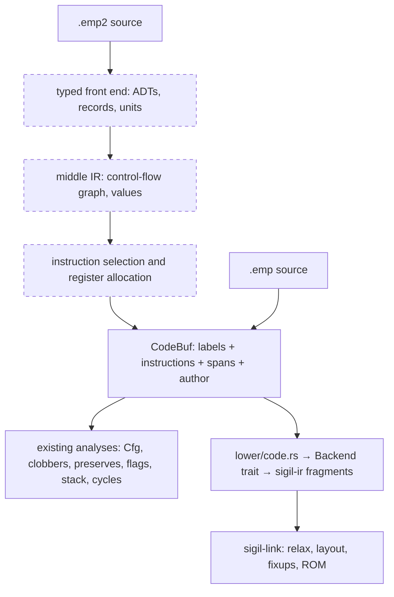

# Sigil assembler: reviewer B

Sigil `7630ba0d`, aeon `936439fa`. Written 2026-11-16. Inputs: [[0-inventory]], [[1-research]],
[[2-measurements]], then the source. I did not read reviewer A or any earlier review of Sigil.

> [!verdict] On par with the best common tools overall. Keep the core, patch the front end, rewrite the driver beside
> - **As an assembler and linker it is sound.** The encoders, the fixup range checks and the relaxation
>   fixpoint are careful, and the bytes are reproducible. I rebuilt aeon HEAD's `s4.bin` in a scratch
>   copy and got the same file as the live tree (MEASURED).
> - **It is ahead of every common assembler on verification** (register contracts closed over the whole
>   call graph, flag results, stack balance), and that part is a hard build gate, not a lint.
> - **It is behind them on three things a toolchain is judged by:** debug info (symbols only),
>   the form of its diagnostics, and building anything that is not Aeon. A second game needs Rust
>   edits and a rebuilt Sigil today.
> - **One real wrong-code hole:** `.emp` instruction immediates are truncated in silence (finding 1).
>   Two comments each say the other layer checks. Neither does.
> - **Added in the checker round:** region sizes are mostly unenforced (finding 8), the Z80 side gets
>   weaker checking and no debug symbols (findings 9 to 11), and the sound driver's layout is Rust
>   (Q1 extended). The scale and the dispositions do not change. See [[#Checker round]].
> - **Scale: on par.** Disposition: **keep** `sigil-isa`, `sigil-ir`, `sigil-link`, the back ends, the AS
>   front end and the compression crates. **Patch** `sigil-frontend-emp`. **Rewrite beside** the build
>   driver (`sigil-harness/src/native.rs`, the sound seams, the game profiles and the contract
>   baselines), as data owned by the game repo.
> - **Compiled tier:** the bottom half of the architecture is right for it. The right target is the
>   `.emp` front end's `CodeBuf`, not `sigil-ir`. Everything above that (typed IR, control flow,
>   register allocation, instruction selection) does not exist.

## What I ran

All in the scratch area. Nothing was written to a repo except this file. Machine: 16 threads, shared
with other audit agents, load average 9.5 to 11.6 during my runs.

| Run | Result | Label |
|---|---|---|
| `cargo build --release --locked --bin sigil` into `audit-builds/sigil-revB` | Finished in 20.05 s (cargo's figure), exit 0 | MEASURED, release, wall clock |
| `sigil build --aeon <copy of aeon HEAD> --native --game sonic4` | 2.74 s wall, 2.45 s user; 850,296 bytes; sha256 `1d679068eb1180ff…`, equal to the live `aeon/s4.bin`; 170 warnings | MEASURED, release Sigil, one run |
| 8,000 four-instruction procs in one module, `sigil emp` | 6.30 s wall | MEASURED, release, one run |
| 22 single-file probes (`sigil emp`, `sigil <file.asm>`) | Listed in section 6 and in Walk B | MEASURED |
| 18 stack samples of the s4 build and 3 of the 8,000-proc build, by interrupting under `gdb` | Listed in findings 2 and 3 | MEASURED, coarse; `gdb` slows the run |
| The test suite | **DID NOT RUN** by me. Stage 2's totals stand: 5,864 passed, 3 failed, 3 ignored | |

## 1. Requirements

| For | What the toolchain must do | Today |
|---|---|---|
| **Sonic 4 vertical slice** | Build the ROM byte-exactly and reproducibly in a few seconds. Refuse wrong code. Tell Oracle which source line an address is. | Builds in 2.7 s. Refuses most wrong code, not all (finding 1). No line info. |
| **Mega-acts and infinite levels** | Large data sets through comptime and `embed`. Banked data with checked pointers. Budgets per region. Fast rebuild after a data edit. | Regions, banks and budgets exist. *(Corrected in the checker round: only one budget and the per-section `bank:` window are enforced; region sizes mostly are not. Finding 8.)* Every build is a full build. |
| **Named non-Sonic game: a 4 MB Thunder Force IV-scale ROM with heavy Z80 sound** | A different sound driver layout. Many Z80 modules. A ROM at the top of the flat window. | The Z80 back end and cycle tables exist. The **sound driver's file list and load address are Rust constants** (`seam1.rs:131-151`). 4 MB is the hard ceiling (`map.rs:35`); no mapper. |
| **A second game sharing the engine** | `--game <name>` from a project file, with its own contract residue and shapes. | `sigil build --game thunder` is refused (stage 2). Profiles are Rust functions (`native.rs:309-601`). |
| **A compiled higher tier** | Host a second lowering path whose output the same checkers judge. | Possible at the `CodeBuf` level. See "Compiled tier". |

**Budget targets** (ESTIMATED; my proposal, derived from stage 2's figures):

| Budget | Target | Today | Label |
|---|---|---|---|
| Full build, Aeon | 1 s or less | 2.74 s | MEASURED |
| Rebuild after one `.emp` edit | 0.3 s or less | 2.85 to 2.97 s | MEASURED (stage 2) |
| Peak memory, Aeon | 250 MB or less | 119 MB | MEASURED (stage 2) |
| Full build at 3 times Aeon's source | 3 s or less | about 8 s by linear scaling | ESTIMATED |
| Wrong bytes accepted without a diagnostic | 0 known cases | at least 3 forms (finding 1) | MEASURED |

**Worst case it must survive:** a generated or compiled module with thousands of small procs. Today
that is quadratic (finding 2).

**Interfaces:** aeon `build.sh` (through `SIGIL_BUILD` and `SIGIL_EMIT`), Oracle (the `.lst`), the
in-ROM error handler (the deb2 appendix, made by shelling out to `aeon/tools/convsym`), Aurora (none
yet). **Non-goals:** replacing AS for the community; object files; CPUs other than 68000 and Z80.

## 6. Correctness

### Summary

| # | Finding | Severity | Proven by |
|---|---|---|---|
| 1 | `.emp` instruction immediates are truncated in silence | High: wrong bytes, exit 0 | Reproduction and code |
| 2 | Compile time is quadratic in procs per module; the cause is two evaluators built per proc | Medium now, high for a compiled tier | Stack samples and code |
| 3 | One build walks the corpus at least four times | Medium: speed | Stack samples |
| 4 | `sigil build --check` writes into the source tree | Medium | Code |
| 5 | A `const` type annotation is not enforced | Medium | Reproduction |
| 6 | Bit numbers above the operand's size are accepted | Low | Reproduction |
| 7 | Single-file `sigil emp` checks less than `sigil build` and says so nowhere | Low | Reproduction and code |

Edges I probed and found **correct** (all MEASURED, exit 1 with a clear message): `moveq #200`,
`addq #9`, `subq #0`, `lsl #9`, `trap #20`, a proc at an odd address, a word field at an odd struct
offset, `bra.s` with displacement 0, `move.b` to an address register, a `.l` read of a 2-byte field, a
duplicate proc, `($8000).w`, a `data` element that does not fit its type. Link-time fixups are all
range-checked (`sigil-link/src/lib.rs:735-775`, `:855-920`). Section overlap is an error (`lib.rs:1031`).

### Finding 1: silent truncation of immediates

> [!finding] 1. `move.w #$12345, d0` assembles to `303C 2345` and exits 0
> **Reproduction** (`sigil emp`, release, MEASURED):
>
> | Source | Bytes | Exit |
> |---|---|---|
> | `move.w #$12345, d0` | `303C 2345` | 0 |
> | `move.b #300, d1` | `123C 002C` | 0 |
> | `andi.b #$1FF, d0` | `0200 00FF` | 0 |
> | `cmpi.w #$FFFFF, d1` | `0C41 FFFF` | 0 |
> | `move.w #-40000, d0` | `303C 63C0` | 0 |
>
> **Cause, in code.** The `.emp` lowering checks only that the value fits 32 bits, and its comment says
> the encoder does the rest: "the encoder does the size-specific business-rule check"
> (`sigil-frontend-emp/src/lower/code.rs:1396-1405`). The encoder masks instead
> (`sigil-isa/src/m68k.rs:1907-1911`: `(v as u16) & 0x00FF`, `v as u16`), and its module doc says the
> opposite: "that validation is the front-end's responsibility, not the encoder's" (`m68k.rs:17-19`).
> Each layer documents that the other one checks.
>
> **The check already exists three times elsewhere:** the AS front end (`sigil-frontend-as/src/eval.rs:3337`),
> the link-time word immediate (`sigil-link/src/lib.rs:752-775`), and the Z80 path of the same file
> (`lower/code.rs:2035-2052`). So `move.w #Label, d0` is checked and `move.w #$12345, d0` is not.
>
> **Test that fails first:** in `sigil-frontend-emp/tests/`, lower `move.w #$12345, d0` and
> `move.b #300, d1` and assert an error diagnostic. Then sweep the Aeon corpus with the check on; each
> firing is either a real bug or a spelling to fix.
>
> **Fix:** apply AS's window (signed floor to unsigned ceiling for the operand size) in
> `lower/code.rs` beside the 32-bit check. Not byte-changing for code that is already in range.

### Finding 2: quadratic in procs per module

> [!finding] 2. Each proc builds two whole-file evaluators on a new 64 MB-stack thread
> Stage 2 measured the 4x-per-doubling curve. I reproduced one point: 8,000 procs, 6.30 s (MEASURED).
> Three stack samples of that run all sit in `lower_proc` → `eval_proc_body_lowering` → a scoped
> thread join.
>
> **Cause, in code.** `eval_proc_body_full` (`eval/mod.rs:2069-2091`) runs once per proc. Inside it:
> - `Evaluator::with_file_and_ambient(file, ambient)` is called **twice** (`:2070`, and a `probe` at
>   `:2088` that is dropped a few lines later). Each call runs `index_items(&file.items)` over the
>   whole file (`eval/mod.rs:848-849`).
> - The whole body runs under `run_on_eval_stack`, which spawns an OS thread with a 64 MB stack
>   (`eval/mod.rs:1916-1940`). There are about 26 call sites of that function in the crate.
>
> So lowering a module costs (procs) x (items in the file). The doc comment above says so in passing:
> "lowering builds a FRESH evaluator per proc" (`eval/mod.rs:1958-1959`).
>
> **Why it matters:** Aeon's largest module has 55 procs, so this is latent today. A compiled tier that
> emits many small procs, or any generated module, pays it in full.
>
> **Test that fails first:** a timing-free form: count `index_items` calls while lowering a 200-proc
> module and assert the count does not grow with the proc count.
>
> **Fix:** build the file's index once per module and share it; give each proc only a fresh mutable
> state. Run one big-stack thread per build, not one per evaluation.

### Finding 3: the corpus is walked several times per build

> [!finding] 3. A 2.7 s build is at least four front-end passes, not one
> 18 stack samples of the s4 build (MEASURED, coarse, taken under `gdb`). Where the samples landed:
>
> | Phase (outermost frames) | Samples |
> |---|---|
> | `run_contract_gate` → `analyze_corpus_with_contracts` → `eval_proc_body_env` | 1 |
> | `resolve_chained` → `emit_generated_in` → `seam2::*` → `lower_emp_file` / `Manifest::scan` | 3 |
> | `assemble_as_side` → `harvest_engine_ram_addresses` → `build_program_open_embed` | 2 |
> | `build_emp` → `build_program_with` (comptime evaluation: `eval_for`, `eval_call`, `eval_guard`) | 12 |
>
> The contract gate lowers every proc body again. The sound seam lowers the sound modules again and
> rescans the manifest. The residual 899 lines of `.asm` cost a whole extra program build, only to
> harvest RAM addresses for them. The real build then does it all once more.
>
> I cannot give a per-phase share from 18 samples. The claim is only the count of passes, which the
> call chain in `native.rs:3833-3841` and `main.rs:2128` confirms by reading.
>
> **Gain if fixed** (ESTIMATED): the 12 of 18 samples in the real build bound the single-pass cost at
> roughly two thirds of today's wall time, before any parallelism. The build is single-threaded
> (stage 2: user/wall 0.89) on a 16-thread machine, and modules are independent until link.

### Finding 4: a check command that writes

> [!finding] 4. `sigil build --check` regenerates files inside the source tree
> `check_chained` (`native.rs:3937`) calls `resolve_chained`, whose first act is
> `emit_generated_in(aeon, …)` (`native.rs:3833-3836`), which writes
> `<aeon>/engine/sound/generated/` (`native.rs:845`). Stage 2 measured 15 files rewritten on every
> invocation. A command named "check" changes the tree it checks; two builds of different shapes on one
> tree race on the same files (the writes are atomic per file, not per set). The build also needs
> `aeon/tools/convsym` and a temp directory for the debug appendix (`native.rs:4809-4840`).
>
> **Test that fails first:** run `sigil build --check` on a read-only copy of Aeon; it must pass.
>
> **Fix:** hold the generated sound artifacts in memory, or under the output directory. Emit the deb2
> appendix natively.

### Findings 5 to 7

> [!finding] 5. `const X: u8 = 300` is accepted, and `X` is 300
> `const X: u8 = 300` then `move.w #X, d0` gives `303C 012C`, exit 0 (MEASURED). The same constant in
> a `[u8; 2]` data item is refused (`[emit.out-of-range] 300 does not fit u8`). So the annotation is
> not checked where the constant is defined; only the use site's own width matters. I did not trace
> the code path. **Test:** a `const` whose value does not fit its declared type must be an error at
> the definition.

> [!finding] 6. `btst #40, d0` and `bset #9, (a0)` are accepted
> They assemble to `0800 0028` and `08D0 0009`, exit 0 (MEASURED). The 68000 takes the bit number
> modulo 32 for a data register and modulo 8 for memory, so these test bit 8 and set bit 1. A typo in
> a bit number is silent. **Test:** both must warn or fail.

> [!finding] 7. `sigil emp` and `sigil build` enforce different things
> A proc that declares `clobbers(d0)` and calls a proc that clobbers `d1` builds clean under
> `sigil emp` with no message (MEASURED). That is by design: the transitive closure needs the whole
> call graph (`closure.rs:1-31`) and runs only in `sigil build` (`main.rs:2131-2160`). The single-file
> command does not say that it skipped it. **Fix:** print one line when the closure tier did not run.

### What happens when a budget is exceeded

Object-bank budget, a `bank:` section over its 32 KB window, branch range and cycle budgets all fail
the build with numbers in the message.

> [!note] Corrected in the checker round (2026-11-16)
> This paragraph first read "Region overflow … all fail the build … I found no case where an exceeded
> budget produces a ROM." **That was wrong.** A declared region size is enforced only when the region is
> the first `rom` region containing the section's address. I have since built a ROM, exit 0, with a
> Z80 bank overrun by 13,888 bytes. See finding 8 in [[#Checker round]].

## 7. Code quality

### Idiom and residue counts

Counts are stage 0's (MEASURED there) unless marked "mine" (MEASURED here by grep).

| Template check | Toolchain form | Count |
|---|---|---|
| Build-time work done at run time | Whole-corpus passes per build | at least 4 (finding 3, mine) |
| Layout literals | The literal `sonic4` in non-comment `src` lines | 123 lines in 18 files |
| | `engine/` or `games/` path literals in harness `src` | 87 lines in 6 files, 34 in `native.rs` (mine) |
| Hand-spelled pins | Aeon proc names in `contract_baseline.rs` | 39 rows (mine) |
| | Generated address pins in `pins.rs` | 522 `pub const` (mine) |
| Hand-kept protocols | The immediate-range contract between `sigil-isa` and the front ends | 2 comments, contradictory (finding 1) |
| | The `.lst` shape, written to satisfy "four consumer grammars" by regex | `listing.rs:130-160` |
| Assembler residue | Comment lines mentioning `asl` / `.asm` / `twin` | 1,368 / 392 / 80 in `src` |
| History in comments | Dated comment lines; decision ids | 164 in `src`, 324 in `tests`; 97 + 97 |
| | Comment share of non-blank `src` lines | 37% |
| Failure paths | `panic!` and `unwrap`/`expect` in `src` | 212 and 1,232 |
| Dead or test-only surface | `pub` items used only by tests | 598, of which 558 in `sigil-harness` |

### Findings

> [!finding] Q1. Aeon is compiled into the assembler
> - Game shapes are Rust functions returning `&'static str` paths and define lists (`native.rs:309-601`).
> - The sound driver's five files, their order and their load address are constants (`seam1.rs:1-15`,
>   `:131-151`).
> - The contract gate is a ratchet against **named Aeon procs** (`contract_baseline.rs:137`, for
>   example `("Air_Collide", "Air_WallProbeLeft", "d4")`). When Aeon factored `Air_Collide` out of
>   `PState_AirShared`, the Sigil source had to change (`contract_baseline.rs:138-146`).
> - 62 `*_port.rs` test files in `sigil-cli/tests` are named after Aeon engine files.
>
> So an engine refactor can need a Sigil commit, a Sigil rebuild and a golden re-freeze. `provenance.toml`
> holds 207 freeze entries (stage 0). `aeon/build.sh` records an incident where the shared Sigil binary
> sat three days behind and nothing noticed (`build.sh:652-660`). A second game cannot be added without
> editing Rust. This is the largest maintainability cost in the tree.

> [!finding] Q2. The build driver lives in the test harness crate
> `sigil-cli` depends on `sigil-harness` (stage 0 §2). `native.rs` is 7,396 lines and holds the real
> build: profiles, the AS-side harvest, placement, the declared chain, sound validation, the listing
> and the appendix. The same crate holds golden gates, pins and provenance. 558 of its `pub` items are
> used only by tests. Driver and test scaffolding should be separate crates.

> [!finding] Q3. Debug info is a counterfeit AS listing
> `emit_listing` writes one fake `(0) n/ADDR : Name:` line per symbol so Oracle's AS-listing parser
> accepts it, then a symbol table shaped so a second tool reads that half and Oracle ignores it
> (`listing.rs:130-160`). Every instruction fragment already carries its source span
> (`sigil-ir/src/lib.rs:29-36`, `builder.rs:312-316`), and `SourceIndex::locate` turns a span into
> `file:line:col` (`resolve/manifest.rs:178-182`). A line table is a walk the code can already do. It
> is not written.

> [!finding] Q4. The cycle-budget feature is used once
> `@budget(cycles: N)` appears on **1 of 607 procs** in Aeon (`engine/system/dma_queue.emp:358`;
> mine, MEASURED by grep). `@cycles_exact` appears 0 times. The implementation is `cycle_budget.rs`
> (2,002 lines) plus the two cost tables. The reason is in its own header: any loop is
> `[cycles.unbounded-loop]` and any call is `[cycles.opaque-call]` (`cycle_budget.rs:27-30`). It can
> only bound a loop-free leaf. It cannot bound a VBlank handler, which is what the frame audit needs.
> By contrast `clobbers(...)` is on 596 of 607 procs: that feature earned its place.

> [!finding] Q5. Instructions are stringly typed above the encoder
> `CodeItem::Instr` holds `mnemonic: String`, and register sets are `BTreeSet<String>` (`value.rs:465-492`,
> `closure.rs:41-49`). Every analysis matches on text. A compiled tier that emits `CodeBuf` would build
> strings to be re-parsed by the lowering.

> [!finding] Q6. Diagnostics have no structure and no catalogue
> `Diagnostic` is level, message, one span (`sigil-span/src/lib.rs:423-431`). Codes are text inside the
> message. `[cycles.over-budget]` appears in no doc under `empyrean/docs` or `sigil/docs/*.md` (mine,
> grep). Examples from my probes: a duplicate proc reports at `1:1` as "symbol `f` redefined by section
> `text`"; `move.w d0, $FFFF8000` reports "illegal destination EA: #imm"; errors print out of line order.

> [!note] Smaller items
> - `sigil-frontend-as/src/eval.rs`: one `impl Asm` block runs from line 2334 to 13288 (mine). It works
>   and is gated by real `asl` vectors, so I would leave it alone.
> - Known-attribute names are a closed list in the parser (`parser.rs:307-310`), and three other sites
>   key on the name `budget` alone (`lower/proc.rs:597`, `:681`; `cycle_fraction.rs:492`).
> - `docs/superpowers/` is 426,645 lines against 315,996 lines of Rust (stage 0). The boot file
>   `OVERSEER.md` opens by explaining where its own rules moved to. A new contributor cannot find the
>   design from the docs; the code comments are the real documentation, which is why they are 37%.

### Do the gates test what they claim?

| Gate | Claim | Verdict |
|---|---|---|
| ISA vectors, Capstone differentials | Encodings are right | Yes. Independent of Sigil. |
| Sonic 1 and Sonic 2 built whole against a pinned real `asl` | AS front end, back ends and linker are right on a corpus that did not grow up with Sigil | Yes (stage 2 ran them). The strongest gate in the tree. |
| 7 whole-ROM goldens | Aeon's ROM is right | No: they prove Sigil equals its earlier self, at an aeon revision 63 commits old (stage 2). |
| 62 `*_port` gates | A module's bytes match a golden region | Same limit as the goldens. They were the port's proof; now they mostly restate the whole-ROM check. |
| Contract closure gate | No new contract violation | Yes, as a ratchet. |

By my count 976 of 5,867 `#[test]` functions sit in files that need an Aeon tree or a golden (mine,
MEASURED by a file-level grep, so approximate). The other 4,891 test the toolchain alone. That ratio is
healthy. The 976 are the ones that turn an engine edit into toolchain work.

## Walk B (the tool's own form): the same routine both ways

I wrote one small real routine twice: a countdown that reloads a timer and calls a helper.

| | AS syntax (`sigil w.asm`) | `.emp` (`sigil emp w.emp`) |
|---|---|---|
| Bytes | `5328 0024 6A0C 117C 0040 0024 4EB9 0000 0014 4E75 4E75` | identical (MEASURED, `cmp`) |
| Field typo `timr(a0)` | "unresolved symbol `timr` in operand" | "`*Obj` has no field or in-scope overlay field `timr`" |
| `move.w #WAIT, timer(a0)` on a byte field | builds, exit 0: writes into the next field | "`.w` access reads 2 bytes but field `timer` is 1 byte", exit 1 |
| `move.b #300, …` | "operand 300 out of range -128..=255", exit 1 | builds, exit 0 (finding 1) |

The two routes meet at the same bytes, which is the architecture working. `.emp` catches a class of
bug AS cannot (field width). AS catches one `.emp` does not (immediate range). The second is a defect
to fix, not a trade.

## Walk B (mandatory): adding one small feature end to end

**The feature: `@budget(stack: N)`.** A proc declares the most stack bytes it may use, callees included.
The frame process review listed "stack depth with HBlank, VBlank and the decoder bookmark nested" as
unexamined, so the engine audits will want this.

What already exists: a symbolic stack model with depth (`preserves.rs:541-571`, `run_stack_dataflow`
and its `StackObserver`), a call-graph closure (`closure.rs`), a budget attribute, and a build gate.

| # | Step | Crate / file | Change |
|---|---|---|---|
| 1 | Language decision | `empyrean/docs/SIGIL_SPEC2_LANGUAGE.md` (frozen for v1) | A recorded decision adding the second budget resource |
| 2 | Accept the syntax | `sigil-frontend-emp/src/parser.rs:323-350` | `validate_attr_form` hard-codes "exactly one argument named `cycles`". Allow `stack:`, alone or with `cycles:` |
| 3 | Stop the cycle checker misreading it | `sigil-frontend-emp/src/lower/proc.rs:597`, `:681-687` | Both select on the attribute name `budget` and then assume the first argument is `cycles`; today a stack-only budget would take the "already reported" error path with nothing reported |
| 4 | Local peak depth | `sigil-frontend-emp/src/preserves.rs` | A new `StackObserver` that records the maximum depth, and the depth at each call site |
| 5 | Z80 parity | `sigil-frontend-emp/src/z80_preserves.rs` | The same, or a loud `[stack.budget-unsupported]` on Z80 procs |
| 6 | Run the local check | `sigil-frontend-emp/src/lower/proc.rs` (beside `check_stack_balance`, `:310`) | `check_stack_budget`, new codes `[stack.over-budget]`, `[stack.unbounded]` |
| 7 | Close over calls | `sigil-frontend-emp/src/closure.rs:54` (`ProcNode`) | New fields. The existing fixpoint is a set union that tolerates recursion; depth is max-plus, so recursion must be detected and refused. This is new algorithm, not a new row |
| 8 | Feed the closure | `sigil-frontend-emp/src/corpus_contracts.rs:65` (`ContractReport`), `:2307` (`proc_node`), `:2435` (`extern_node`) | A new firing family. Extern procs need a declared depth, which means a new clause on `extern proc` (`ast.rs:1414`, parser again) |
| 9 | Gate the build | `sigil-cli/src/main.rs:2153` (`run_contract_gate`), `:2384` (`print_contract_report`) | Wire the family in by hand in both |
| 10 | Baseline | `sigil-harness/src/contract_baseline.rs` | Zero-firing, or another table of Aeon names |
| 11 | Side tool | `sigil-harness/src/bin/cycle_fraction.rs:492` | It counts any `@budget` as a cycle budget |
| 12 | Interrupt allowance | Aeon side | A project constant for the interrupt frames added on top; nowhere to put it today except a define |

**Tests that change or are added:** `sigil-frontend-emp/tests/cycle_budget.rs` (50 tests; the
attribute-form cases), a new `tests/stack_budget.rs`, unit tests in `preserves.rs` and `closure.rs`,
`sigil-cli/tests/contract_closure_corpus.rs` (report shape), `cli_help.rs` if the help text changes,
and one negative fixture in Aeon's `emp_expect_fail` lane. No golden changes: the feature emits no bytes.

**Size** (ESTIMATED from the sizes of the neighbouring features): 3 crates, 10 to 12 source files, 5 or
more test files, 600 to 900 lines of Rust including tests.

> [!finding] Walk B result: feasible in days, with four points of friction
> 1. **No registry of contract families.** A new family is wired by hand into the report struct, the
>    gate, the printer and the baseline. Miss one and it is computed but never enforced; the gate's own
>    comment names that failure ("a baseline that no gate reads is dark", `main.rs:2275-2277`).
> 2. **Attribute arguments are validated in the parser**, so a semantic extension is a grammar change,
>    and three other sites key on the attribute's name alone.
> 3. **The closure is specialised to register sets.** Any numeric property (stack, cycles) needs its
>    own fixpoint. The same work would unlock call-inclusive cycle budgets (finding Q4).
> 4. **Externs carry no cost facts**, so every new whole-program property needs new syntax on
>    `extern proc`.
>
> A struct-layout feature (say `@align` on a field) is cheaper: `layout.rs` and `parser.rs` only, with
> no closure, gate or baseline. The verification side is where features are expensive.

## Compiled tier: does the architecture fit?

Dashed boxes do not exist.

| Piece | State | Evidence |
|---|---|---|
| Encoders for both CPUs, with cycle tables | Exists | `sigil-isa`; `Backend` trait `sigil-ir/src/backend.rs:42-57` |
| Relaxation: the tier can emit unsized branches and let the linker pick | Exists | `Fragment::RelaxLadder`, `sigil-ir/src/lib.rs:149-159` |
| An instruction-level form that carries spans and authorship | Exists | `CodeBuf` / `CodeItem`, `value.rs:316-492`. `ItemAuthor` already separates user-written from compiler-inserted lines (`value.rs:337`) |
| A per-proc control-flow graph over that form | Exists | `Cfg`, `flag_check.rs:708-730`, reused by `preserves.rs` |
| Checkers that can judge compiler output | Exists | clobbers, preserves, flags, stack balance, closure. This is the real asset: a code generator's output can be **verified against the declared contract on every build** |
| Types and layout for records | Exists | `layout.rs` (2,892 lines), `eval/typed.rs` |
| A typed IR above instructions (values, blocks) | Missing | `sigil-ir` is fragments of bytes and link expressions only (`lib.rs:76-169`, `expr.rs:65-75`) |
| Register allocation, instruction selection, calling convention | Missing | grep `regalloc`: 0 hits (stage 0) |
| Sum types, pattern matching, effect lists | Missing | |
| A typed mnemonic and operand enum at the `CodeBuf` level | Missing | finding Q5 |
| Linear cost in procs per module | Missing | finding 2 |
| Line-table output, so compiled code can be debugged at source level | Missing | finding Q3. Without it a compiled tier is undebuggable |
| Cycle bounds through loops and calls | Missing | finding Q4. A compiler that owns instruction choice needs this to prove it met a budget |

> [!verdict] The seam is one level higher than the ideas note says
> `SIGIL_IDEAS_FUNCTIONAL_TIER.md` describes "a third front-end lowering into the same IR". Lowering
> into `sigil-ir` would bypass every checker, because they run on `CodeBuf`, not on fragments. The
> tier should emit `CodeBuf` (or `.emp` text) inside `sigil-frontend-emp`, or `CodeBuf` and its
> analyses should move into their own crate first. That extraction is the one structural change I
> would make before any tier work. It also answers the "restart" question for this tool: `sigil-isa`,
> `sigil-ir`, `sigil-link` and the `CodeBuf` analyses survive any language redesign; the parser,
> resolver and comptime evaluator (the bulk of the 33,474 code lines in `sigil-frontend-emp`) are what
> a new language would replace.

"Functional everywhere" (the owner's added question) needs a Z80 code generator written in-house, and
needs cycle-exact output for the driver. Nothing in Sigil helps there beyond the Z80 encoder and cost
table. That half is the language audit's call; from the tool's side, an exact-instruction escape hatch
already exists and is the current language.

## Maintainability for one person plus agents

- **In favour:** small sound core (isa + ir + link + back ends are about 7,600 code lines); a clean
  one-way crate graph enforced by a test; strong independent gates on that core; determinism; every
  refusal is loud; code comments explain why.
- **Against:** 5,160 commits in three months produced a tree where the design is spread across 37%
  comments and 426K lines of agent notes; the driver, the game and the test harness are one crate;
  the engine's proc names live in the tool; a full test run is 9 minutes in release (stage 2) and
  the edit-compile loop on the front end is 16 s (stage 2).
- **Net:** one person can keep the core. One person cannot hold `sigil-harness` and the process docs
  in their head, and should not have to: most of it is Aeon-port scaffolding whose job ended when the
  port did.

## 8. Verdict and plan

**Scale: on par with the best common tools.** By axis:

| Axis | Position |
|---|---|
| Encoding, linking, relaxation, reproducibility | Best known |
| Contract verification | Beyond |
| Value-range checking in `.emp` | Below (finding 1) |
| Debug info | Below (AS `-g`, vasm, ca65 all emit line tables) |
| Diagnostics form | Below |
| Build speed | On par in absolute terms; below what the design allows |
| Incremental build, editor support | Below |
| Second game, other Z80 driver | Below: needs Rust edits |

**Disposition**

| Part | Disposition | Reason |
|---|---|---|
| `sigil-isa`, `sigil-ir`, `sigil-link`, back ends, compression crates | **Keep** | Independently gated, small, correct in everything I probed |
| `sigil-frontend-as` | **Keep**, frozen | Gated against real `asl` on Sonic 1 and 2; only 899 lines of Aeon still need it |
| `sigil-frontend-emp` | **Patch** | Findings 1, 2, 5, 6, Q5; extract `CodeBuf` and its analyses |
| Build driver, profiles, sound seams, baselines, pins (`sigil-harness`) | **Rewrite beside** | Finding Q1 and Q2. A data-driven project file read from the game repo, with the old driver as the byte reference |
| Port gates and landing scaffolding | **Retire** in step with the rewrite | Their claim is now covered by the whole-ROM check |

### Ranked improvements

| # | Improvement | Gain | Cost (ESTIMATED) | Risk | Depends on | Changes ROM bytes? |
|---|---|---|---|---|---|---|
| 1 | Range-check `.emp` immediates and typed consts; warn on bit numbers | Closes the only wrong-code hole found | 1 day plus a corpus sweep | Low; may fire on existing Aeon lines, each one a real question | none | No, unless the sweep finds a real bug |
| 2 | Emit a line table (address range → file:line, per fragment span) and teach Oracle to read it | Source-level debugging; unblocks every engine audit's runtime work | 3 to 5 days across Sigil and Oracle | Low | none | No |
| 3 | One front-end pass per build; index a module once; one eval thread | About 1.5x to 3x faster builds; removes the quadratic | 1 week | Medium; goldens guard it | none | No |
| 4 | Project file in the game repo: shapes, defines, sound module list, contract baseline | A second game without touching Rust; engine refactors stop needing Sigil commits | 2 to 3 weeks | Medium | 3 helps | No |
| 5 | Stop writing into the source tree; native deb2 appendix | Hermetic, read-only `--check`, parallel shapes | 3 days | Low | none | No |
| 6 | Move the golden expectation to the aeon side at aeon HEAD | "Green" means today's ROM | 2 days | Low | 4 | No |
| 7 | Extract `CodeBuf` + analyses into a crate with typed mnemonics | The seam a compiled tier needs; faster analyses | 2 weeks | Medium | 3 | No |
| 8 | Structured diagnostics: code field, secondary span, source excerpt, JSON; a generated catalogue | Readable errors; the base for an editor | 1 to 2 weeks | Low | none | No |
| 9 | Numeric closure: call-inclusive cycle and stack budgets, declared loop bounds | Turns a one-use feature into whole-frame budget proofs | 2 weeks | Medium | 7 | No |
| 10 | Parallel per-module lowering | Near-linear on 16 threads for the front end | 1 week | Medium (determinism) | 3 | No |

### Beyond-state-of-the-art candidates

| Candidate | Plausibility |
|---|---|
| Every build checks compiler-generated code against the same contracts as hand-written code | High once improvement 7 lands; the checkers exist |
| A machine-checked worst-case VBlank cost against the frame budget (improvement 9) | Medium: needs loop bounds declared and DMA stall modelled |
| Oracle showing the declared contract (clobbers, requires, held context) at a breakpoint | High after improvement 2; the data is already computed |
| Incremental relink under a section firewall, well under 100 ms | Medium; only worth it after 3 and 10 |

### Dropped ideas

| Idea | Why dropped |
|---|---|
| LLVM or Cranelift as the tier's back end | No Z80 target; M68k is experimental (stage 1) |
| Adopting salsa now | The build is 2.7 s with four redundant passes; fix those first |
| AS compatibility as a community wedge | S.C.E. fails with 120 errors (stage 1); not on the engine's path |
| Object files and separate linking | One flat image, whole-program checks; no gain |
| Mapper or bank switching above 4 MB | No requirement yet; flag it when a game needs it |
| Rewriting `frontend-as/eval.rs` for tidiness | Gated by real `asl`, nearly unused by Aeon; pure risk |

## Coverage table

"Lines read" counts source lines I read in full; greps and listings are named as such. Most of the
316K lines were not read. Rows say so.

| Crate / path | Size (raw lines) | Lines read | Result |
|---|---|---|---|
| `sigil-span` | 1,284 | `lib.rs:415-432` | finding Q6 |
| `sigil-isa` | 6,744 src | `m68k.rs:10-26`, `:515-535`, `:1895-1935` | finding 1. Z80 encoder, decoder, cycle tables: not read |
| `sigil-ir` | 2,835 | `lib.rs` all non-test code (1-572), `backend.rs` all, `expr.rs:17-140`, `fixup.rs:1-117`, `builder.rs:312-340`, `map.rs:35` | read, nothing wrong; basis for the tier section |
| `sigil-backend-m68k` | 621 | grep hits only (`:79-178`) | not read |
| `sigil-backend-z80` | 245 | none | not read |
| `sigil-link` | 9,867 src | `lib.rs:735-920`, `:1031`, `:1042-1071`; `relax.rs:1-40`, `:896-908`; `listing.rs:130-180` | fixups and emit: read, nothing. Listing: finding Q3. `blob.rs`, `code_file.rs`, the relax body: not read |
| `sigil-frontend-as` | 27,558 src | `eval.rs:2440-2462`; a structure scan of `eval.rs` | note under section 7. Otherwise not read |
| `sigil-frontend-emp` | 60,218 src | `lower/code.rs:1390-1450`, `:2015-2060`; `lower/proc.rs:585-740`; `eval/mod.rs:827-856`, `:1900-2100`; `closure.rs:1-60`; `cycle_budget.rs:1-60`; `parser.rs:300-350`; `ast.rs:1071-1130`; `value.rs:315-350`, `:452-560`; `flag_check.rs:700-730`; function list of `corpus_contracts.rs`; grep over `preserves.rs` | findings 1, 2, 5, 6, 7, Q4, Q5; Walk B. `layout.rs`, `resolve/`, `eval/asm.rs`, `out_verify.rs`, `mul_lower.rs`, Z80 analyses: not read |
| `sigil-harness` | 30,197 src | `native.rs:300-330`, function list, `:3833-4012`, `:4809-4840`; `contract_baseline.rs:120-150`, `:280-330`; `pins.rs:1-30`; `seam1.rs:1-25`, `:131-151` (grep) | findings 3, 4, Q1, Q2. `seam2.rs`, `repin.rs`, `provenance.rs`, `test_support.rs`: not read |
| `sigil-cli` | 5,206 src | `main.rs:2120-2175`, `:2340-2380`, grep of `:2175-2340`; `tests/dma_queue_port.rs:1-70`; test file listing | finding 7, Walk B. `asl_mode.rs`, `build.rs`, the other 182 test files: not read |
| `emit_sound_blob` binary | n/a | entry point only (`seam1.rs:919-925`) | not read |
| `sigil-s4lz`, `sigil-salvador-sys`, `sigil-clownlzss-sys`, `sigil-clownnemesis-sys` | about 1,900 Rust | none | not read |
| `scripts/`, `tools/` | 10,837 | file listing only | not read |
| `editors/vscode` | 184 | grep only | read, nothing (a grammar; no attribute list to update) |
| `examples/` | 1,544 | `composition_pitcher_plant.emp:1-60` | read, nothing |
| `docs/OVERSEER.md` | 758 | 1-30 | note under section 7 |
| `docs/QUEUE.md` | 1,687 | headings; `:826-840` | challenge 1 |
| `docs/decisions.jsonl`, `lane-status.json`, `DRIFT_RECORD_SEAM.md` | 54 rows; n/a; 127 | first row; first 500 bytes; 1-20 | read, nothing |
| `docs/OVERSEER-LOG.md`, `OVERSEER-REFERENCE.md`, `docs/superpowers/` | 7,098; 4,917; 426,645 | none | not read |
| `aeon/build.sh` | 2,078 | 30-60, 640-660, 786-800, 1368-1380, 1448-1458 | finding Q1 (the stale-binary incident) |
| `empyrean/docs/SIGIL_IDEAS_FUNCTIONAL_TIER.md` | 141 | all | tier section |

## Challenges to stages 0 to 2

> [!note] Challenges
> 1. **Stage 0 headline, "There is no current independent oracle for whole-ROM bytes": too broad.**
>    The strict suite builds stock Sonic 1 and Sonic 2 whole through Sigil's AS route and compares
>    against a pinned real `asl` (stage 2 §5.2 ran this; `sigil-cli/tests/as_sonic2_whole_rom.rs:1-27`).
>    `QUEUE.md:826-828` records Sonic 3 & Knuckles byte-identical as well (PUBLISHED there; I found no
>    gated test for it). The true statement is narrower: no independent oracle for **Aeon's** ROM or
>    for the `.emp` front end.
> 2. **Stage 1 F-R2, "Sigil's AS front end is fitted to Aeon, not to AS": overstated** for the same
>    reason. It builds three stock disassemblies. It fails S.C.E. on specific missing forms. "Fitted
>    to the corpora it has been pointed at" is the accurate reading.
> 3. **Stage 2 §5.8, "Contract enforcement: Weak": true of `sigil emp`, not of the build.** The 3a
>    case was run through the single-file command. `sigil build` runs a default-on whole-corpus
>    closure gate that exits 1 on any new firing (`main.rs:2131-2160`, `:2371`). The local
>    `[proc.clobber-undeclared]` lint is a warning in both.
> 4. **Stage 2 item 5, "`const W: u16 = $12345` … accepted and truncated": the constant is not
>    truncated.** `const X: u8 = 300` then `move.w #X, d0` emits `012C` (MEASURED). The annotation is
>    ignored and the full value flows on; truncation happens only at the instruction's width. The
>    defect is real, and it is two defects (findings 1 and 5).
> 5. **Stage 0 §8, "`corpus_contracts.rs` holds contracts specific to the Aeon corpus": not what I
>    found.** A grep of its non-comment lines for `sonic4`, `ojz`, `aeon`, `RunObjects` and `engine.`
>    returns nothing. It is the generic whole-corpus analysis. The Aeon-specific rows are in
>    `sigil-harness/src/contract_baseline.rs`.
> 6. **Stage 1 uses 1.15 s for `sigil build` throughout its targets table.** Stage 2 measured 2.92 s
>    and I measured 2.74 s. The research gaps computed from 1.15 s ("about at target") are too kind.
> 7. **The named workload.** From memory, not checked in this stage: the retail Thunder Force IV
>    cartridge is 8 Mbit (1 MB), not 4 MB. The 4 MB case is still the right ceiling test for the flat
>    window; it should not be described as that game's real size without a source.
> 8. **Stage 2's scaling finding gives no cause.** It is `eval/mod.rs:2069-2091` (finding 2).

## Checker round

Written 2026-11-16 in answer to [[5-checker]]. One round. Sigil `7630ba0d`, aeon `936439fa`, the same
release `sigil` binary as before (`audit-builds/sigil-revB`). New probes ran in
`audit-builds/revB-r2/`, on scratch copies of aeon HEAD. Nothing was written to a repo except this file.

> [!verdict] The checker was right on all four gaps. The scale stays "on par"; the Z80 half is weaker than I said
> - **I was wrong about budgets.** A region's declared size is checked only in narrow cases. I built a
>   ROM, exit 0, whose bank-1 sound section overruns its 32 KB Z80 window by 13,888 bytes (finding 8).
> - **The Z80 side had not been read. It now has.** The encoder, back end and cost table are sound.
>   Three things are not: the whole-program clobber check does not gate Z80 code (finding 9), `.emp`
>   Z80 cannot address a label as `(Label)` (finding 10), and the build listing holds no Z80 driver
>   symbol at all (finding 11).
> - **A different sound driver cannot be linked through `sigil build` without Rust edits.** It *can* be
>   linked through `sigil emp --root --map` with no seam: I built a two-module Z80 driver with banked
>   data that way. So the language and linker are capable; the build driver is the obstacle.
> - **Q1 is larger than I wrote.** 23 module ids, 399 driver constant names, 26 handler names and the
>   four-stage bank order are Rust literals.
> - **Dispositions unchanged.** Findings 8 to 11 all sit in the parts already marked patch or rewrite.

### What I ran this round

Machine as before: 16 threads, shared with other audit agents. All builds are release Sigil, one run
each, wall clock not recorded (these are pass/fail probes, not timings).

| # | Probe (scratch copy of aeon HEAD unless noted) | Result | Label |
|---|---|---|---|
| base | Unchanged copy | exit 0; 850,296 B; sha256 `1d679068eb1180ff…` | MEASURED |
| e1 | `map.toml`: `z80_sound_bank` size `0x8000` → `0x100` | exit 0; **identical ROM** (same sha256) | MEASURED |
| e2 | `map.toml`: `object_bank` size `0x10000` → `0x100` | exit 1: "budget region `object_bank` … over by 10956 bytes" | MEASURED |
| e3 | 11 extra 2,876 B items in `song_bank2` (a `bank: $8000` section) | exit 1: "cannot fit a 0x8000 bank, over by 8474 bytes" | MEASURED |
| e4 | `map.toml`: `rom` size `0x400000` → `0x80000` | exit 1: "overflows region `rom` … over by 40410 bytes" | MEASURED |
| e5 | 8 extra 2,876 B items (23,008 B) after the bank-1 SFX block | exit 1: `[map.undeclared-island]` "add `[[anchor]] at = 0xC8000`" | MEASURED |
| e7 | e5, then follow that advice: `song_bank_2` anchor `0xC0000` → `0xC8000` | **exit 0; 883,143 B.** Bank-1 data runs to `0xC3640`; the window ends at `0xC0000` | MEASURED |
| e8 | Z80: `Audit_P () clobbers(a, f)` calls `Audit_Q () clobbers(a, b, f)` in `sound_psg.emp` | **exit 0.** No diagnostic names either proc, also with `SIGIL_WARNINGS=full` | MEASURED |
| e9 | 68000: the same pair with `d0`/`d1` in `engine/system/math.emp` | exit 1: "`[proc.clobber-undeclared]` closure firings, 1 firing(s)" | MEASURED |
| z1 | New program, no aeon: 68000 module + two Z80 modules + one banked data module, `sigil emp --root . --map map.toml` | exit 0; 32,772 B; bytes checked by hand (below) | MEASURED |
| z2 | z1 with region `drv_pcm` shrunk to 4 B (the section is 7 B) | exit 1: "overflows region `drv_pcm` … over by 3 bytes" | MEASURED |
| z3 | z2 with the first region `text` widened to cover `drv_pcm` | **exit 0; same bytes as z1** | MEASURED |
| z4 | `.emp` Z80: `ld a, (WaveBank)` where `WaveBank` is a data label | exit 1: "a Z80 indirect base must be … a comptime address `(nn)`" | MEASURED |
| z5 | AS route: `ld a,(Var)`, `ld (Var),a`, `ld hl,(Var)`, `ld (Smc+1),a` | exit 0; `3A0F00 320F00 2A0F00 320D00`, correct | MEASURED |
| u1 | AS route: `cpu z80`, `ixl equ 5`, `ld a,ixl` | exit 0; `3E 05`, which is `ld a,5` | MEASURED |
| u2 | u1 without the `equ` | exit 1: "unresolved symbol `ixl` in operand" | MEASURED |

The test suite: **DID NOT RUN** by me in this round either. Stage 2's totals stand.

### Gap 1. Region overflow reaches the ROM

> [!finding] 8. A declared region size is enforced only when that region is the first `rom` region holding the section's address
> **Severity: medium for Aeon today, high for the named workload.** No Aeon ROM is wrong today. The
> mechanism that would stop a wrong one is missing in three places.
>
> **Cause, in code.**
> - `MemoryMap::validate_section` finds the region with `region_for(lma)`, which returns the first
>   region of kind `rom` that contains the address (`sigil-ir/src/map.rs:99-101`, `:135-136`). It does
>   not use the region the section was named into.
> - Aeon's map lists `rom` `[0, 0x400000)` first (`aeon/games/sonic4/map.toml`, the first `[[region]]`).
>   So in the real build every section is checked against the whole cartridge and nothing smaller.
> - `z80_sound_bank` is kind `z80_bank`, not `rom`, so `region_for` never returns it. Its `size` is
>   read by nothing on the build path (probe e1: shrinking it to `0x100` gives the same ROM).
> - `check_budget` is a no-op unless the region's kind is `ObjectBank` (`map.rs:118-120`), and its one
>   caller passes the literal name `"object_bank"` (`sigil-harness/src/native.rs:4479`). So a map can
>   hold exactly one enforced budget, and its name is in Rust.
> - `place_sections` reads no region size, and the seam-2 emitters stop at `link` without `emit_rom`.
>   So their seven synthetic region sizes are unenforced. I count them at `seam2.rs:531-532`, `:739`,
>   `:964-965`, `:1047`, `:1204`, `:1378` (by reading; `mt_bank` at `:1563` is sized from the real room).
>   `sound_tables_z80` is 1,116 B against `0x400` (MEASURED: the file in `engine/sound/generated/`).
>
> **What does hold** (MEASURED): the one object-bank budget (e2), a single `bank: $8000` section larger
> than its window (e3), and the end of the cartridge (e4).
>
> **Reproduction that produces a ROM (e5, e7).** Bank 1 is three sections in one window. Only the last
> one being pushed into the next anchor stops growth, and the message then is
> `[map.undeclared-island] … add [[anchor]] at = 0xC8000`. Doing what it says gives exit 0 and a
> ROM in which bank 1's section holds bytes from `0xC0000` to `0xC3640`: 13,888 B past the window the
> Z80 can see with that bank selected. My padding is data nothing reads. Real SFX or song data there
> would be read through a `winptr()`, which is a mask and not a range check (`sigil-link/src/lib.rs:1594`),
> so the Z80 would read the same offset in the wrong bank.
>
> **Reproduction through the public CLI (z2, z3).** `sigil emp --help` says `--map` "places each
> section into its named region, against that region's budget". A 7 B section in a 4 B region is
> refused (z2). List a wider `rom` region first and it is accepted, byte-identical (z3).
>
> **Tests.** The four `gap_*` tests in `sigil-harness/tests/seam2_region_unenforced.rs` already pin
> this as current behaviour; stage 2's strict run passed them. The fix inverts them. Add one more that
> fails first: a `z80_bank` region with two sections whose sum passes the window must be refused.
>
> **Fix.** Check each section against the region it was placed into by name. Enforce `size` for every
> region kind. Let `[[budget]]` name any region. In seam 2, derive each size from the bank room, as
> `mt_bank` already does. The queue row sizes this S to M and I agree. Not byte-changing.

**Weighing it for the 4 MB, Z80-heavy workload.** A 4 MB ROM is up to 128 bank windows of 32 KB. That
game's map is where a per-bank size matters most, and today:

| What the game's author writes | Enforced? |
|---|---|
| One section per bank with `bank: $8000` | Yes (e3) |
| Several sections sharing a bank, as Aeon's bank 1 does | Only by the next anchor; the suggested repair hides the overflow (e7) |
| A `z80_bank` region with a `size` | No (e1) |
| A second `[[budget]]` for another region | No: the region name is a Rust literal |
| A `rom` sub-region nested in the cartridge region | No (z3) |

So the safe pattern exists and Aeon's own song bank 2 uses it. The unsafe patterns are accepted in
silence, and Aeon's bank 1 uses one of them.

### Gap 2. The Z80 side

Read this round (lines read in the coverage addendum below).

| Part | Judgment |
|---|---|
| `sigil-isa/src/z80.rs` (encoder) | **Read, nothing wrong.** Table-driven; resolved operands only; the documented instruction set. No undocumented forms (`sll`, the `ixh`/`ixl` halves): they are refused, not mis-encoded, apart from u1 below |
| `sigil-backend-z80` (245 lines, all read) | **Read, nothing.** `jr`→`jp` is a two-rung relaxation ladder; `jp`/`call`/`ld rr,nn` to a label use the range-checked `Value16Le`, not the masking bank-pointer kind (`lib.rs:63-90`) |
| `z80_cycles.rs` cost table (`:237-478`, all read) | **Read, nothing wrong.** I checked every row against the Zilog T-states from memory: no error found. A unit test ties the table to the encoder's accepted forms. Two limits, below |
| `z80_preserves.rs`, `z80_out_verify.rs`, `z80_bus.rs` (headers and structure) | **Read, nothing.** Generic; no Aeon names in code lines (grep). They reuse the shared `Cfg` |
| `seam1.rs`, `seam2.rs` | Findings Q1 (extended), 8 and 11 |

> [!finding] 9. The whole-program clobber check does not gate Z80 code
> A Z80 proc that declares `clobbers(a, f)` and calls a proc that clobbers `b` builds clean: exit 0, no
> message at any warning level (e8). The same mistake in 68000 code fails the build (e9). The Z80
> closure exists (`seam1.rs:1037-1060`, `z80_clobbers_report`), but its only callers are in
> `sigil-cli/tests/z80_clobbers_incomplete.rs` (grep). So it runs when someone runs Sigil's test suite
> against an aeon tree, not when the engine builds. It also filters by Aeon proc name:
> `name.starts_with("Seq_Op_") || name == "Seq_ContinueFetch"` (`seam1.rs:1030-1032`).
> **Severity: medium.** My first-round claim "contract verification: beyond" holds for 68000 only.
> The per-proc Z80 `preserves` and `out` proofs do run in the build; I did not doctor those.
> **Test that fails first:** probe e8 as an aeon `emp_expect_fail` fixture. **Fix:** run the same
> closure over Z80 modules inside `run_contract_gate`, with the exclusion declared in source.

> [!finding] 10. `.emp` Z80 cannot write `ld a, (Label)`
> `(nn)` must be a compile-time integer (`eval/asm.rs:2470-2484`; `CodeOperand::Z80Mem { addr: i128 }`,
> `value.rs:733-737`). A link-resolved label is refused (z4). The AS route assembles all four forms
> (z5). Aeon's driver works around it and says so: "The `ld hl`/`ld a,(hl)` pair (4 B, not a 3 B
> `ld a,(nn)`)" (`aeon/engine/sound/z80_sound_driver.emp:1253`).
> **Cost:** 17 T-states and a lost `hl` against 13 T-states (PUBLISHED Zilog timings), and no
> self-modifying operand (`ld (Patch+1), a`), which sample-playback loops commonly use.
> **Severity: medium for the named workload, low for Aeon** (its variables are constants in Z80 RAM).
> A driver that keeps variables or tables inside its own image cannot be written naturally.
> Related, also MEASURED: `ld hl, winptr(X)` and `move.w #bankid(X), d0` are refused; both values are
> allowed in data cells only. That one is refused loudly and has a workaround (a table).
> **Fix:** let `Z80Mem` carry a link expression with a `Value16Le` fixup, as `lower_abs16` already
> does for `jp`/`call`/`ld rr,nn`.

> [!finding] 11. The build listing contains no Z80 driver symbol
> The driver enters the ROM as an embedded blob (`boot_data.emp:205`, `Z80_Sound_Start = ShapeBlob`).
> In the listing my build wrote, `SndDrv_SetBank`, `Psg_NoteOn` and `Seq_Op_Dac` appear 0 times
> (MEASURED, grep of the `--emit-lst` output). `engine/sound/generated/` holds 15 `.bin` files and no
> symbol file. So Oracle gets no names for 6,228 bytes of Z80 code from the toolchain.
> This compounds the known row `PHASE-ROW-CPU`: the six `PHASE` rows carry no address space
> (`sigil-link/src/listing.rs:198`), and `SoundTablesZ80_Head` is listed at `8000`, the same number as
> real 68000 code. Finding Q3's line table must record the address space too, or it repeats this.
> **Severity: medium** (debug info, the audit's named axis for Oracle).

> [!note] Smaller Z80 items
> - **The Z80 cost table is in the wrong crate.** The 68000 table is `sigil-isa/src/m68k_cycles.rs`.
>   The Z80 one is in `sigil-frontend-emp` and matches on mnemonic strings and `CodeOperand`
>   (`z80_cycles.rs:237`). The AS route and any compiled tier cannot use it. Same class as Q5.
> - **The cost model is pure Zilog.** I found no term for the delay a Z80 read of banked ROM takes on
>   this hardware. A cycle-exact sample loop that reads the bank window is budgeted without it. I did
>   not measure the size of that delay; flag for the sound audit.
> - **A 68000 reference to a Z80-space label gives the Z80 address.** In z1, `lea Drv_Entry, a0`
>   assembled to `41F8 0000`. The driver's image sits at ROM `0x200`. There is no built-in for a
>   symbol's load address (the built-ins are listed at `eval/call.rs:60-100`), which is one reason
>   Aeon's driver goes through a blob with data labels around it.
> - **No independent Z80 oracle on this machine.** The eight late-added one-byte opcodes are checked
>   against Oracle's Z80 core, not an assembler (`sigil-isa/tests/z80_missing_primitives.rs:12-22`).
>   The rest are 153 frozen `asl` vectors (stage 0's count).

**Can a different sound driver layout be linked without the Rust seams?**

| Route | Answer | Evidence |
|---|---|---|
| `sigil emp --root --map` | **Yes.** Two Z80 modules calling across files, a banked data module, a 68000 module, one map | z1: `F3 31FE1F CD0001 210D00 7E 18F7` then `0080` (`winptr`) and `01` (`bankid`); `Pcm_Tick` at ROM `0x300`. All correct by hand |
| `sigil build` (what `aeon/build.sh` runs) | **No.** | The five driver files and their order (`seam1.rs:128-156`); 399 constant names the driver may import, listed per file (`seam1.rs:1426-1560`, counted by script); 26 handler names (`seam1.rs:84`); six envelope control values as Rust literals that "mirror the generated data module" (`seam1.rs:1348-1353`); the bank chain DAC → head → `Song_MovingTrucks` → `Sfx_33` (`seam2.rs:63-76`); the paths `games/sonic4/map.toml` and `games/sonic4/data/sound/sfx` (`seam2.rs:106`, `:923`) |

The seams exist because the port moved the driver out of AS one file at a time ("asl packs the
not-yet-flipped remainder", `seam1.rs:9-12`). With `asl` gone from the build, the driver could be plain
sections in the one program, and seams 1 and 2 could go. Three things block that today: finding 10's
missing load-address built-in, the pointer folding seam 2 does ahead of placement, and the driver's
cross-file constants being fed by name from Rust instead of by `use`. This is the same rewrite as my
improvement 4, and it is the bulk of it.

### Gap 3. Q1 extended: more of Aeon in the tool

> [!finding] Q1 (addition). 23 module ids decide which builds include a module, and they are a Rust table
> `SHAPE_GATES` (`sigil-harness/src/module_roots.rs:129-165`) has **23 rows** (MEASURED by script: 17
> `games.sonic4.*`, 4 `engine.*`, 2 through named constants). The checker counted 22 and the queue row
> says 21; one module holds two rows during a rename. `gate_of` matches by exact id, and **no match
> means "every shape places it"** (`:186-188`). So a module renamed or added on the aeon side falls
> out of its gate in silence and is built into shapes it was excluded from.
>
> The open rows record exactly that:
>
> | Row | State | What it shows |
> |---|---|---|
> | `MT-BANK-RENAME-PAIR` (`QUEUE.md:1655`) | steps 1 and 2 done | Aeon held a zero-byte module rename until Sigil had landed a second row and installed a new binary. The table still carries both ids (`module_roots.rs:154-155`; the queue row cites `:151`, which has drifted) |
> | `ORDER-WHEN-SHAPE-GATES` (lane-status) | open | The fix (a `when` per map row) is known and waits on a map-format change |
> | `EDITOR-BINDING-COUPLING` (`QUEUE.md:954`) | open / blocked | Four places in Sigil key on a name Aeon's editor tools invent. I read the row, not the four sites |
>
> Adding these to the first-round list, the Aeon names compiled into Sigil are: the game profiles, the
> contract baseline (39 rows), 23 shape gates, 399 + 26 sound names, the bank order, the per-section
> alignment table (`sigil-harness/src/section_align.rs`, named by aeon's own comment in
> `song_bank2.emp`; not read), and 62 port gates.

**The second-game port, revised.** To add `games/thunder` with its own driver, in order:

| Step | Where | Rust edit? |
|---|---|---|
| A profile for `--game thunder` | `native.rs:309-601` | Yes |
| Its debug and sound-only modules | `module_roots.rs:129` | Yes, or they are built into every shape in silence |
| Its sound driver files, constants, handlers | `seam1.rs` | Yes |
| Its bank layout | `seam2.rs` | Yes: the chain and both head labels are constants |
| Its section alignments above 16 | `section_align.rs` | Yes |
| Its contract residue | `contract_baseline.rs` | Yes, unless zero-firing |
| Its per-bank budgets | `map.toml` | Accepted and not enforced (finding 8) |
| Rebuild and install the shared `sigil` binary | — | Yes; `aeon/build.sh:652-660` records it once sitting three days stale |

`games/demo` avoids most of this only because it has no driver of its own.

### Gap 4. Known open defects

| Known defect | My status | Note |
|---|---|---|
| `SEAM2-TABLE-REGION-UNENFORCED` | **Found (this round)**, reproduced and extended | Finding 8. Wider than the row: the `z80_bank` size and the single hard-named budget are not in it |
| `PHASE-ROW-CPU` | **Found (this round)** | Confirmed at `listing.rs:198`. Folded into finding 11. The row's own analysis is right: `Section.cpu` is the encoder, not the address space, so the fix is a new section attribute |
| `PUB-STRUCT-SIZE-MANDATORY` | **Found, by count only** | 54 `pub struct` in aeon `engine/` and `games/`, 11 with `(size: …)`, so 43 without (MEASURED, line grep; the row says 42 and asks for a recount). I did not read the spec clause or look for an enforcement site. Low: a spec word with no check, not wrong bytes |
| `AS-Z80-UNDOC-REGISTER-NAMES` | **Found (this round)**, reproduced | u1: with `ixl equ 5`, `ld a,ixl` assembles to `3E 05` in silence. Real `asl` under `cpu z80undoc` would emit `DD 7D` (from memory of the Z80 opcode map, not run). Low for Aeon (no AS-route Z80 left). It matters only if a disassembly's driver is fed through the AS route |
| `WARN-TIER-UNPINNED-PREFIXES` | **Unexamined** | I read the lane-status title only; the row has no body in `QUEUE.md` or `OVERSEER-LOG.md` that I could find. I did not derive 519 or 1,169. My own figure is 170 warnings in a plain s4 build, of which the summary line names seven families |
| `ORDER-WHEN-SHAPE-GATES`, `EDITOR-BINDING-COUPLING`, `MT-BANK-RENAME-PAIR` | **Found (this round)** | Q1 addition above. The four editor-binding sites: unexamined |
| CI red on master since 2026-09-28 | **Unexamined** | Not sent to me. I ran no `gh` command |
| S12 warn-tier narrowing; S14 firing location | **Partly seen** | e9's failure text names no proc and no file: "closure firings, 1 firing(s); this family is zero-firing by contract". That agrees with reviewer A's F3 as the checker describes it. Not traced |
| `DEAD-SAVE-DOC-AND-FLOOR-STALE`, `PARTIAL-ROWS-PRINT-PLAIN-OK` | **Unexamined** | Out of the gaps sent |
| The three FFI crates and `sigil-s4lz` (14 `unsafe` blocks) | **Unexamined** | Still not read |

### Smaller corrections to my first round

- **Test count.** My "5,867 `#[test]` functions" came from a file-level grep with a looser pattern.
  Use stage 0's 5,857. The 976 / 4,891 split is approximate for the same reason.
- **"Contract verification: beyond"** in the axis table applies to 68000 code. For Z80 it is "on par
  with a lint": per-proc proofs run, the closure does not gate (finding 9).
- **Finding 7** understated: the build itself also skips a tier, for Z80.

### Changes to section 8

The scale is unchanged: **on par with the best common tools.** Two axis rows change.

| Axis | Was | Now |
|---|---|---|
| Encoding, linking, relaxation, reproducibility | Best known | Best known for encoding, relaxation and reproducibility. **Region and budget enforcement: below** (finding 8; `ld65` and GNU `ld` refuse an overfull memory area) |
| Contract verification | Beyond | Beyond for 68000. On par for Z80 (finding 9) |
| Second game, other Z80 driver | Below: needs Rust edits | Below, and by more: six Rust sites, and the map's budgets are not enforced |

Additions to the ranked improvements. None changes ROM bytes.

| # | Improvement | Gain | Cost (ESTIMATED) | Risk | Depends on |
|---|---|---|---|---|---|
| 1b | Enforce region sizes by name, for every kind; any number of `[[budget]]` rows; derive seam-2 sizes | Closes finding 8. Do it with improvement 1 | 2 to 3 days | Low. `sound_tables_z80` is over its literal today, so derive that size in the same change | none |
| 1c | Run the clobber closure over Z80 modules in the build gate | Closes finding 9 | 2 days | Low; the corpus is reported zero-firing in scope | none |
| 2b | Z80 symbols and an address-space column in the debug output | Closes finding 11 and `PHASE-ROW-CPU`. Part of improvement 2 | +2 days on improvement 2 | Low; needs a section attribute, which is language surface | 2 |
| 4b | Driver as plain sections: link-time `(Label)` operands, a load-address built-in, then delete seams 1 and 2 | A second driver with no Rust. Closes finding 10 | Most of improvement 4's 2 to 3 weeks | Medium: the blob bytes must not move; the goldens guard that | 4 |

### Coverage addendum

Rows that change from the first-round table. Everything else stands.

| Path | Size (raw lines) | Lines read this round | Result |
|---|---|---|---|
| `sigil-ir/src/map.rs` | — | 95-250 | finding 8 |
| `sigil-harness/tests/seam2_region_unenforced.rs` | 184 | all | finding 8 |
| `sigil-harness/src/seam2.rs` | 2,065 | 40-130, 195-260, 300-390, 917-960, 1187-1250, 1776-1818; item index of the whole file; grep of every `size =` | findings 8, Q1. The DAC, SFX and MT emitters' bodies: not read |
| `sigil-harness/src/seam1.rs` | 1,555 | 1-60, 84-100, 120-200, 1000-1060, 1320-1372, 1415-1445; item index | findings 9, 11, Q1 |
| `sigil-harness/src/module_roots.rs` | 450 | 100-200 | Q1 addition |
| `sigil-harness/src/native.rs` | 7,396 | +4462-4482 | finding 8 |
| `sigil-harness/src/section_align.rs` | — | none (grep of its callers) | not read |
| `sigil-backend-z80/src/lib.rs` | 245 | all | read, nothing |
| `sigil-isa/src/z80.rs` | 1,752 | 1-200; item index; grep for undocumented forms. `encode` body (584-865): not read line by line | read, nothing wrong; exercised by z1, z5 |
| `sigil-isa/tests/z80_missing_primitives.rs` | 71 | 1-40 | note (oracle) |
| `sigil-frontend-emp/src/z80_cycles.rs` | 1,499 | 1-75, 237-480; item index | read, nothing wrong; two notes |
| `sigil-frontend-emp/src/z80_preserves.rs` | 712 | 1-70 | read (header and model), nothing. Transfer function: not read |
| `sigil-frontend-emp/src/z80_out_verify.rs` | 458 | 1-60 | read (header and model), nothing. Body: not read |
| `sigil-frontend-emp/src/z80_bus.rs` | 275 | 1-50 | read, nothing (it is a 68000-side lint despite the name) |
| `sigil-frontend-emp/src/eval/asm.rs` | — | 2415-2490 | finding 10 |
| `sigil-frontend-emp/src/eval/call.rs` | — | 55-150 | note (built-ins) |
| `sigil-link/src/listing.rs` | — | grep of `PHASE` rows, `:189-198` | finding 11 |
| `docs/QUEUE.md` | 1,687 | 353-366, 954-960, 986-994, 1631-1665 | gap 4 table |
| `docs/OVERSEER-LOG.md` | 7,098 | 6533-6537 | `AS-Z80-UNDOC-REGISTER-NAMES` |
| `docs/lane-status.json` | — | the 7 named rows, by script | gap 4 table |
| `aeon/games/sonic4/map.toml` | — | regions, anchors, budget (comments skipped) | finding 8 |
| `aeon/games/sonic4/data/sound/song_bank2.emp`, `mt_bank.emp`, `soundbankhead.emp` (headers), `sfx_bank_blob.emp:44-100` | — | as listed | finding 8 |
| FFI crates, `sigil-s4lz`, `relax.rs:80-880`, `blob.rs`, `code_file.rs`, `asl_mode.rs`, `build.rs`, `scripts/`, `tools/` | — | none | still not read |
